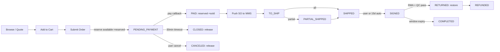
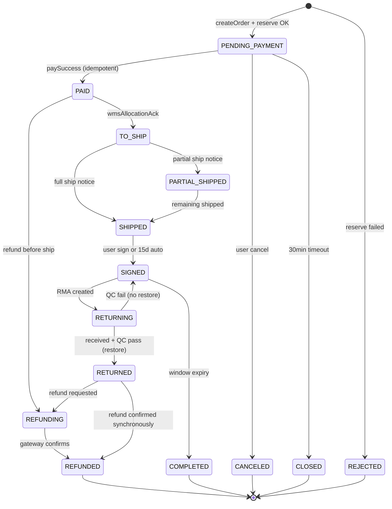
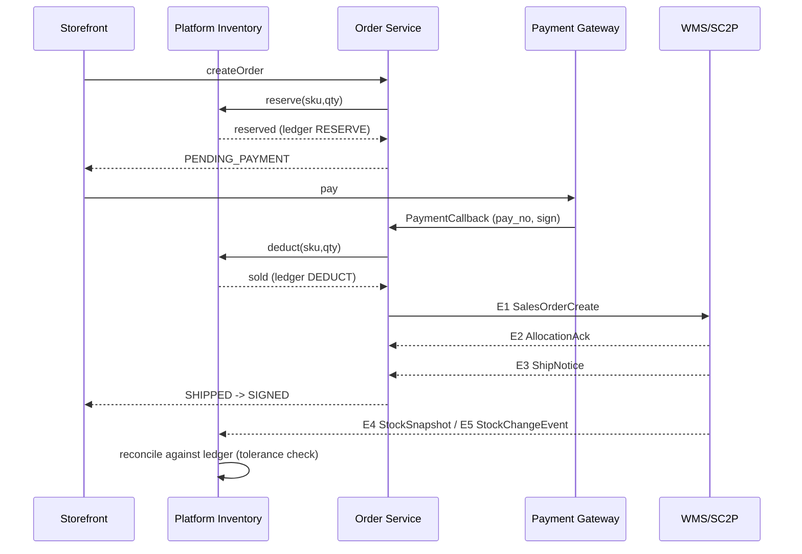
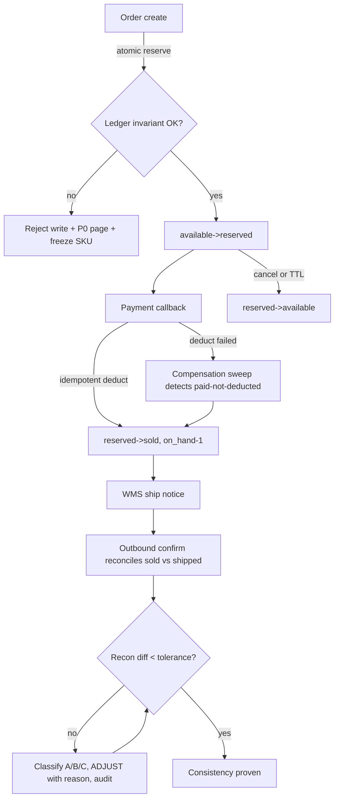

# MFQ Test Plan and Test Case Design

## E-Commerce System (Product / Inventory / Cart / Order / WMS-SC2P Sync)

| Attribute | Value |
|---|---|
| Document | MFQ-ECOM-001 |
| Framework | MFQ - Models / Functional / Quality |
| Version / date | 1.0 / 2026-10-13 |
| Case count | 81 executable cases across 9 modules (F1-F4 and Q1-Q5). The M layer and the dedicated sections contribute models and specifications; the traceability matrix maps each of them to the cases that carry the assertion |
| Reading order | M -> F -> Q -> dedicated sections -> traceability matrix. The dedicated sections are cross-layer summaries; read them after F. |

## 0. Objective

Design a **risk-based test plan** for an e-commerce system using the **MFQ (Models - Functional - Quality)**
framework. The plan must show three things a reviewer can grade independently:

1. **M - Models.** Do we understand the system before testing it? Business flow, order state machine,
   inventory state model, external interaction model, and the *consistency boundaries* between them.
2. **F - Functional.** Does the functional coverage actually exercise those models: happy path, the
   inventory-synchronization contract, boundary/race conditions, and the API contract itself?
3. **Q - Quality.** Are the non-functional risks (performance, reliability, observability, security,
   recoverability) controlled by measurable targets, not adjectives?

The single most expensive defect class in this system is **inventory truth**: an oversell, a double
deduct, a lost deduct or a leaked reservation is either direct money loss or an incorrect promise shown to the customer.
Every layer below is therefore anchored to inventory consistency as the primary risk.

### 0.1 Scope in

- Product/SPU-SKU listing, price and sellable-quantity exposure to the storefront
- Cart validation and order submission (single-SKU, multi-SKU, multi-warehouse)
- Order lifecycle: place -> pay -> allocate -> ship (partial/split) -> sign -> return -> refund -> close
- Inventory states: available, reserved, deducted (sold), restored, frozen
- Bidirectional sync with WMS/SC2P: order push, allocation, ship notice, stock snapshot/stream, inbound receipt, QC result, return receipt
- Payment gateway callback handling and refund write-back
- Customer/admin APIs that mutate order or inventory state, plus their validation contracts

### 0.2 Scope out

- Third-party WMS/SC2P internal logic (covered only through its external interface and fault-injection behavior)
- Payment gateway internals (simulated via sandbox plus callback replay)
- Logistics carrier routing and last-mile optimization
- Marketing/coupon engine business rules (touched only for price-tamper and concurrency checks)
- Native mobile client UI rendering beyond the API contract (only API-level plus one smoke journey)

### 0.3 Assumptions the plan depends on

1. WMS/SC2P is the **authoritative source of physical stock**; the platform owns the sellable (available) view and the reservation ledger.
2. All external messages are **at-least-once**; correctness must come from idempotency, not from exactly-once delivery.
3. Inventory is tracked per **(sku_id, warehouse_code)**; a SKU may be sellable from several warehouses and an order may be split across them.
4. Callback and message processing is **asynchronous**; the storefront may observe states out of order and must never display a state that contradicts the ledger.
5. Peak traffic is flash-sale shaped: a ~10-second burst of 20k+ QPS against a SKU with a few hundred units, i.e. a contention-heavy, low-inventory profile.
6. Environment split: DEV (functional), TEST/STAGE (integration + fault injection + full MFQ run), PERF (isolated data set, production-like topology).

### 0.4 Risk register

**Top product risks driving this plan (and the layer that controls each)**

| # | Risk | Impact | Controlled by | Blast radius |
|---|---|---|---|---|
| R1 | Oversell under flash-sale concurrency (available goes negative) | Direct money loss, legal, brand | F2 / F3 / Q1 / S4 | Whole SKU, all channels |
| R2 | Lost or duplicated deduct between order and WMS | Silent inventory drift, later oversell | F2 / Q2 / S5 | Grows over days |
| R3 | Order stuck in a non-terminal state (paid but never shipped) | Refund cost, CS load, SLA breach | F1 / F2 / Q2 / Q3 | Per order |
| R4 | Duplicate or reordered callback double-applies a state change | Double refund / double deduct | F2 / F4 | Per order |
| R5 | Stale WMS snapshot overwrites in-flight reservations | Phantom stock or lost stock | F2 / S4 | Whole warehouse |
| R6 | Data drift with no repair path | Manual firefighting, audit failure | Q5 / S5 | System-wide |
| R7 | PII leak via logs, callbacks or admin API | Compliance and trust | Q4 | Customer base |
| R8 | Peak overload collapses order creation (cascading failure) | Revenue stop during peak | Q1 / Q2 | Site-wide |

### 0.5 MFQ structure at a glance

- **M: Models** - Five models, each with the invariant or guard that makes it testable.
- **F: Functional** - Functional coverage expressed as a case tree: every case carries an id, a priority, preconditions, steps and an expected result traceable to a model.
- **Q: Quality** - Non-functional risk control: measurable targets, parameterised mechanisms, and drills with explicit targets.
- **Dedicated Sections (mandatory)** - The three sections the brief marks as mandatory, viewed across layers: inventory synchronization consistency, exception handling and compensation, and release entry/exit criteria.

## 1. M: Models

Five models, each with the invariant or guard that makes it testable.

### M1 End-to-End Business Flow Model

The flow crosses three ownership boundaries: **storefront** (order intent and payment), **platform inventory** (reservations and the sellable view) and **WMS/SC2P** (physical stock and outbound execution). Every stage is listed with the inventory effect it must produce, so each stage becomes a directly testable assertion rather than a narrative.

**E2E stages: actor, system action, inventory effect, consistency contract**

| # | Stage | Trigger / actor | System actions | Inventory effect | Consistency contract |
|---|---|---|---|---|---|
| 1 | Browse / quote | Shopper reads SKU | Read SPU-SKU, price, sellable qty | none | Read-your-writes on available qty |
| 2 | Add to cart | Shopper | Validate on-shelf status, re-price | none | Price and qty revalidated again at submit |
| 3 | Submit order | Shopper | Create order, freeze price, reserve stock, create payment intent | available -1, reserved +1 per SKU | STRONG: no oversell, no negative available |
| 4 | Pay | Shopper + payment gateway | Create pay record, receive async callback, mark paid | reserved -1, sold +1, on_hand -1 | STRONG + idempotent on pay_no |
| 5 | Allocate / fulfil | Platform -> WMS/SC2P | Push sales order (SO), receive allocation ACK, receive pick/pack status | none on platform; WMS reserves physically | EVENTUAL, at-least-once, idempotent by SO id |
| 6 | Ship | WMS/SC2P -> platform | Receive ship notice (packages, tracking no, SKU split) | none (deduct already applied at pay) | EVENTUAL; must reconcile platform sold vs WMS outbound |
| 7 | Deliver / sign | Carrier -> platform | Update logistics, confirm receipt, open return window | none | EVENTUAL |
| 8 | Return | Shopper + WMS | Create RMA, receive goods, QC | on QC pass: on_hand +1, available +1, sold -1 | EVENTUAL + compensating |
| 9 | Refund | Platform -> gateway | Refund request, gateway callback | none | STRONG + idempotent on refund_no |
| 10 | Close | Scheduler | Auto-sign (15d), auto-complete (return window), archive | release any leftover reservation on abnormal close | EVENTUAL; must never close with a live reservation |



#### M1.1 Stage-level failure modes (must be covered by F cases)

- Stage 3 fails: reserve times out or WMS says insufficient -> order must be REJECTED, no ledger entry left behind.
- Stage 4 fails after money moved: payment callback lost or gateway error -> order must not stay PENDING_PAYMENT silently; reconciliation job must find and repair it.
- Stage 5 fails: SO push rejected or ACK lost -> order must not be double-pushed; retry must be idempotent by SO id.
- Stage 6 out-of-order: ship notice arriving before allocation ACK must not corrupt state.
- Stage 8 partial: only the returned quantity may be restored; the rest stays sold.
- Stage 10 abnormal close: any non-terminal order closed by a job must release its reservation first.

### M2 Order State Machine

14 states, five of them terminal, and an explicit guard (or an explicit refusal) on every transition. Each transition lists a guard that is enforced before the transition runs. An omitted guard is how a refund gets issued against an already-shipped order, so the guards act as test oracles.

**States**

| State | Meaning (observable) | Terminal |
|---|---|---|
| REJECTED | Order creation attempted but inventory reservation failed | yes |
| PENDING_PAYMENT | Order exists, price frozen, stock reserved, awaiting payment | no |
| CANCELED | Shopper canceled before payment, reservation released | yes |
| CLOSED | Unpaid order auto-closed by timeout job, reservation released | yes |
| PAID | Payment callback accepted, stock deducted (reserved -> sold) | no |
| TO_SHIP | Sales order acknowledged by WMS/SC2P as allocatable | no |
| PARTIAL_SHIPPED | Some SKUs or packages of the order shipped | no |
| SHIPPED | All order lines shipped | no |
| SIGNED | All packages signed for, return window opened | no |
| RETURNING | RMA created, goods in transit back to warehouse | no |
| RETURNED | Goods received and QC passed, stock restored | no |
| REFUNDING | Refund in flight to the payment channel | no |
| REFUNDED | Refund confirmed by gateway callback | yes |
| COMPLETED | Return window expired with no RMA | yes |

**Transitions: event, guard, side effect**

| From | Event | Guard / transition condition | To | Side effects (inventory, external) |
|---|---|---|---|---|
| (new) | createOrder | Cart valid AND reserve(available>=qty) succeeds for all lines | PENDING_PAYMENT | ledger RESERVE per SKU; create payment intent |
| (new) | createOrder | reserve fails (insufficient / timeout) | REJECTED | no ledger entry persisted; metric reserve_fail++ |
| PENDING_PAYMENT | paySuccess (gateway callback) | signature valid AND amount == order amount AND pay_no unseen | PAID | ledger DEDUCT per SKU (reserved->sold, on_hand-1); emit OrderPaid |
| PENDING_PAYMENT | paySuccess (duplicate callback) | same pay_no already applied | PENDING_PAYMENT unchanged | no-op, return success (idempotent), metric duplicate_callback++ |
| PENDING_PAYMENT | payFailed | gateway returns failure | PENDING_PAYMENT unchanged | no ledger change; allow retry within timeout |
| PENDING_PAYMENT | paymentTimeoutJob | now - created_at >= 30min AND not paid | CLOSED | ledger RELEASE per SKU; close payment intent |
| PENDING_PAYMENT | userCancel | not paid | CANCELED | ledger RELEASE per SKU |
| PAID | wmsAllocationAck | SO accepted for at least one line | TO_SHIP | persist SO id, warehouse allocation |
| PAID | refundBeforeShip | not yet shipped AND rule allows | REFUNDING | compensating ledger per policy (see S5) |
| TO_SHIP | shipNotice (partial) | shipped qty < ordered qty | PARTIAL_SHIPPED | record packages, tracking no; sold stays |
| TO_SHIP | shipNotice (full) | shipped qty == ordered qty | SHIPPED | record packages; trigger auto-sign timer |
| PARTIAL_SHIPPED | shipNotice (remaining) | cumulative shipped qty == ordered qty | SHIPPED | record packages; trigger auto-sign timer |
| SHIPPED | userConfirmReceipt | logistics status delivered | SIGNED | open return window (7d for restockable) |
| SHIPPED | autoSignJob | now - shipped_at >= 15d AND logistics delivered | SIGNED | open return window |
| SIGNED | createRMA | within window AND SKU is returnable | RETURNING | create RMA, notify WMS |
| RETURNING | wmsReturnReceived + QCPass | qty received matches RMA | RETURNED | ledger RESTORE (on_hand+1, available+1, sold-1) |
| RETURNING | QCFail | goods not resellable | SIGNED (unchanged, RMA closed) | no RESTORE; ledger note with reason QC_FAIL |
| RETURNED | refundRequested | refund accepted by the gateway and no dispute is open | REFUNDING | create the refund record with reason RETURN_REFUND |
| RETURNED | refundSuccess | gateway confirms the refund (synchronous, or after REFUNDING) | REFUNDED | emit RefundDone; order terminal |
| SIGNED | returnWindowExpiryJob | no RMA within window | COMPLETED | none |
| CANCELED / CLOSED / REJECTED / REFUNDED / COMPLETED | any | state is terminal | unchanged | reject the event, return ORDER_STATE_ILLEGAL |

**Illegal transitions that MUST be rejected (negative oracles)**

| Attempted transition | Expected result |
|---|---|
| SHIPPED -> paySuccess | ORDER_STATE_ILLEGAL, no ledger change |
| CLOSED -> paySuccess | ORDER_STATE_ILLEGAL; payment must be routed to auto-refund instead of reviving the order |
| SIGNED -> shipNotice again | idempotent no-op, no second deduct |
| RETURNED -> RESTORE twice (duplicate return receipt) | second RESTORE rejected as duplicate, ledger unchanged |
| Any transition on an order whose ledger is unbalanced | blocked by invariant check; raises data-consistency alert |



### M3 Inventory State Model

Four buckets (on_hand, available, reserved, frozen) plus a cumulative sold counter, six invariants and one append-only ledger. The invariants are what make inventory testable: every case asserts them **before and after**, and the reconciliation jobs assert them continuously.

**Quantity model (granularity: sku_id x warehouse_code)**

| Field | Meaning | Source of truth | Changed by |
|---|---|---|---|
| on_hand | Physically present stock | WMS/SC2P | Inbound receipt, outbound confirm, return receipt, ADJUST |
| available | Sellable right now (exposed to storefront) | Platform inventory | RESERVE, RELEASE, RESTORE, INBOUND, FREEZE |
| reserved | Held by non-terminal unpaid/pending orders (has a TTL) | Platform inventory | RESERVE, RELEASE, DEDUCT |
| frozen | Blocked from sale (QC hold, damage, channel lock) | Platform + WMS | FREEZE, UNFREEZE, ADJUST |
| sold | Cumulative deducted quantity (ledger concept, not a bucket) | Platform inventory | DEDUCT, RESTORE |
| safety_stock | Configured buffer never exposed to sale | Config | Manual config change |

**Core invariant (asserted by every inventory test case and by the reconciliation job)**

| # | Invariant | Violation symptom |
|---|---|---|
| I1 | available + reserved + frozen == on_hand - safety_stock | Oversell (negative available) or phantom stock |
| I2 | available >= 0 and reserved >= 0 and frozen >= 0 | Negative bucket, immediate P0 |
| I3 | sum(ledger.qty for type=RESERVE - type=RELEASE - type=DEDUCT) == reserved | Leaked or lost reservation |
| I4 | on_hand == snapshot_on_hand + sum(RESTORE + INBOUND - DEDUCT - ADJUST_out) | Platform and WMS disagree on physical stock |
| I5 | every mutation has exactly one ledger entry with a unique idempotency key | Double apply on message replay |
| I6 | every reservation is resolvable: it ends in DEDUCT or RELEASE within its TTL | Stuck order / permanently frozen stock |

**Ledger entry types and their transition**

| Type | From -> To | Trigger | Idempotency key | Reversible |
|---|---|---|---|---|
| RESERVE | available -> reserved | Order create | order_no + sku_id + RESERVE | yes (RELEASE) |
| RELEASE | reserved -> available | Cancel / timeout close / abnormal close | order_no + sku_id + RELEASE | n/a (terminal for that reservation) |
| DEDUCT | reserved -> sold, on_hand -1 | Payment success (WMS outbound confirm reconciles it) | pay_no + sku_id + DEDUCT | yes (RESTORE) |
| RESTORE | sold -> available, on_hand +1 | Return received + QC pass | rma_no + sku_id + RESTORE | no (needs new RMA) |
| FREEZE / UNFREEZE | available <-> frozen | Ops action, QC hold, channel lock | ticket_id + sku_id | yes |
| INBOUND | on_hand +1, available +1 | WMS inbound receipt | receipt_no + sku_id | no (ADJUST to correct) |
| ADJUST | any -> any (with reason code) | Reconciliation job or manual repair | recon_batch_id + sku_id + seq | no; immutable audit entry |

**Cross-channel and multi-warehouse rules**

| Rule | Description | Test implication |
|---|---|---|
| Per-warehouse allocation | An order line may be allocated from any warehouse holding stock; a partial allocation splits the line | Split shipment cases must assert per-warehouse ledger balance, not just the SKU total |
| Channel ring-fencing | Stock may be reserved per sales channel (e.g. shop vs live-stream) | A channel must not be able to consume another channel's ring-fenced stock |
| Reservation TTL ladder | Unpaid 30min -> release; paid 24h unallocated -> escalate to stuck-order alert | Timeout boundary cases must hit the exact boundary instant |
| Safety stock | available never exposes the buffer | Zero-stock cases must check available hits 0 while on_hand may still be > 0 |

```mermaid
flowchart LR
  subgraph Buckets
    AV[available]
    RS[reserved]
    SO[sold]
    FR[frozen]
    OH[on_hand]
  end
  NEW((new stock)) -->|INBOUND| AV
  AV -->|RESERVE| RS
  RS -->|RELEASE| AV
  RS -->|DEDUCT| SO
  SO -->|RESTORE + QC pass| AV
  AV -->|FREEZE| FR
  FR -->|UNFREEZE| AV
  SO -.->|outbound confirm from WMS| OH
  AV -.->|invariant: available+reserved+frozen = on_hand| OH
  ADJ[ADJUST (recon / manual, reason-coded)] -.-> AV
  ADJ -.-> OH
```

### M4 External Interaction Model (Storefront <-> WMS/SC2P)

Nine external messages, each with a direction, a transport, an idempotency key and a declared failure policy. Anything not declared here is undeclared behavior and belongs in the exception taxonomy (S5).

**Message catalog**

| # | Direction | Message | Transport | Key fields | Idempotency key | Failure policy |
|---|---|---|---|---|---|---|
| E1 | Platform -> WMS | SalesOrderCreate (SO push) | HTTPS POST (sync ACK) + MQ retry | so_id, order_no, lines[sku_id, qty], warehouse_hint, ship_to_hash | so_id | Retry x3 exp backoff -> DLQ; order stays PAID with stuck_order alert |
| E2 | WMS -> Platform | AllocationAck | MQ | so_id, allocated_lines[], warehouse_code, shortage_lines[] | so_id + ack_seq | Idempotent apply; shortage triggers partial-allocation branch |
| E3 | WMS -> Platform | ShipNotice | MQ | so_id, packages[], tracking_no, line_qty_shipped, shipped_at | so_id + package_id | Dedup per package; unknown so_id -> park + alert |
| E4 | WMS -> Platform | StockSnapshot (bulk) | MQ batch / SFTP nightly | sku_id, warehouse_code, on_hand, version, snapshot_ts | warehouse_code + version | Version-guarded apply; stale version ignored (never overwrites newer in-flight state) |
| E5 | WMS -> Platform | StockChangeEvent (delta) | MQ | sku_id, warehouse_code, delta, reason, event_ts | event_id | Out-of-order tolerance: apply by event_ts, drop older than last applied ts per SKU |
| E6 | WMS -> Platform | InboundReceipt | MQ | receipt_no, sku_id, qty, warehouse_code | receipt_no | Idempotent; adds to on_hand and available |
| E7 | WMS -> Platform | ReturnReceived + QCResult | MQ | rma_no, sku_id, qty, qc_result(PASS/FAIL), warehouse_code | rma_no + qc_seq | PASS -> RESTORE; FAIL -> no restore, reason logged |
| E8 | Platform -> WMS | CancelSO / DeliveryAddressChange | HTTPS POST | so_id, reason_code / new_address_version | so_id + action + version | Reject if WMS already shipped; platform keeps SHIPPED state |
| E9 | Gateway -> Platform | PaymentCallback / RefundCallback | HTTPS POST (public endpoint) | order_no, pay_no, amount, status, sign, ts, nonce | pay_no / refund_no | Verify sign + ts window + nonce; reject on mismatch, never mutate state |



#### M4.1 Interface contracts that must be frozen before test execution

- Signed OpenAPI/JSON-Schema for E1, E8 and E9, published to the test team and validated by contract tests.
- Message schema version field on every MQ message, with a documented compatibility rule (additive only within a major version).
- Published error-code dictionary shared by platform, WMS and gateway, including retryable vs non-retryable classification.
- Clock-skew tolerance declared (+/-5min) and enforced identically on both sides.
- A mock WMS/SC2P with a fault-injection switch per message type, so every E-case can be driven deterministically.

### M5 Consistency Boundaries and Reconciliation Points

The system cannot make every boundary strongly consistent, and trying to do so is what produces overselling defects. Each boundary is assigned a mode, an authoritative side, a conflict rule and a reconciliation cadence.

**Consistency boundaries**

| # | Boundary | Mode | Authoritative side | Mechanism | Conflict rule |
|---|---|---|---|---|---|
| C1 | Order create <-> inventory reserve | STRONG | Platform inventory | Single transaction on the inventory row (SELECT ... FOR UPDATE / Redis-Lua atomic decrement with DB fallback) | Second concurrent request loses; available never < 0 |
| C2 | Payment callback <-> order state | STRONG | Platform order service | Unique index on pay_no + state guard in the same transaction | Duplicate callback is a no-op; state machine guard wins over the callback |
| C3 | Order <-> WMS sales order push (E1/E2) | EVENTUAL | Platform owns so_id | At-least-once delivery (synchronous ACK with MQ-backed retry) + idempotent SO apply keyed on so_id | WMS allocation is authoritative for warehouse/shortage; platform never re-pushes a live SO |
| C4 | WMS ship notice <-> order status (E3) | EVENTUAL | WMS | Dedup on so_id + package_id | Platform must accept shipment even if the allocation ACK was lost (out-of-order tolerance) |
| C5 | WMS stock <-> platform available (E4/E5) | EVENTUAL | WMS for on_hand, platform for available | Version-guarded snapshot apply; delta events ordered by event_ts | WMS on_hand always wins; an in-flight reservation is never canceled by a snapshot, the drift is reported instead |
| C6 | Return receipt <-> stock restore (E7) | EVENTUAL | WMS QC result | Idempotent RESTORE keyed on rma_no + qc_seq | restore only on QC PASS and only for the received quantity |
| C7 | Refund <-> order closure | STRONG | Platform | Unique index on refund_no + state guard | refund callback for an unknown/closed order goes to manual queue, never auto-revives the order |

**Reconciliation points and cadence**

| Cadence | Reconciliation job | Scope | Tolerance | Action on breach |
|---|---|---|---|---|
| Real time | Reservation TTL guard | reserved buckets older than TTL | 0 breaches | auto RELEASE + ledger entry + metric |
| Real time | Invariant assertion (I1/I2/I5) on every write | all mutations | 0 violations | reject the write; page P0 |
| Every 5 min | DLQ sweep and replay | dead-letter queue | DLQ == 0 after replay | alert if DLQ > 0; manual approval above 100 messages |
| Every 5 min | Stuck-order detector | orders non-terminal longer than stage SLA | < 50 stuck orders | alert; auto-compensate where a safe rule exists |
| Hourly | Inventory diff job: platform (available+reserved+frozen) vs WMS (on_hand - safety_stock) | all sku x warehouse | diff ratio < 0.05% per warehouse | classify A/B/C and auto-repair A, page on ratio breach |
| Nightly | Full stock snapshot reconciliation (E4) + three-way order/payment/shipment recon | all SKUs; yesterday's orders | 0 unexplained diffs | generate ADJUST with recon_batch_id; publish audit report |
| Nightly | Ledger balance recon (I3/I4/I6) | whole ledger | 0 unbalanced SKUs | freeze the SKU from sale + P0 alert until repaired |
| Weekly | Audit report + drift trend | all reconciliations | trend not degrading | review and tune thresholds |

#### M5.1 Why these modes (design rationale to defend in review)

- C1 is strong because an oversell is unrecoverable: you cannot un-sell 200 units of a 100-unit SKU.
- C4 is eventual and must tolerate the lost-ACK case, because the physical shipment already happened; refusing the ship notice corrupts customer-visible reality.
- C5 lets WMS win on on_hand but never lets a snapshot silently delete a live reservation, otherwise a bulk sync becomes an oversell machine.
- C2 and C7 are strong because a duplicated payment effect moves real money and shows up as a chargeback.
- Every eventual boundary carries a named reconciliation point and a numeric tolerance; a boundary without one is treated as an untested defect.

## 2. F: Functional

Functional coverage expressed as a case tree: every case carries an id, a priority, preconditions, steps and an expected result traceable to a model.

### F1 Core Happy Path and Order Acceptance

End-to-end acceptance of the models in M1 and M2. These cases must be automated as the regression spine; every later case in F2/F3 is a deviation from one of them.

#### F1-01 Create order: single SKU, sufficient stock in one warehouse  `P0`

**Tags:** `happy-path`, `inventory` · **Traceability:** `M1`, `M2`, `M3`, `M5/C1` · **API / artifact:** `POST /api/order/create`

**Precondition**

1. SKU-A on shelf, price 100.00, available = 10 in WH01
2. User U1 authenticated with a valid token

**Steps**

1. POST createOrder {skuId: SKU-A, qty: 1}
2. Read order status
3. Read inventory for SKU-A/WH01
4. Read the ledger

**Expected result**

1. HTTP 200 with order_no and status = PENDING_PAYMENT
2. Ledger has exactly one RESERVE entry (qty 1, key order_no+SKU-A+RESERVE)
3. available 10 -> 9, reserved 0 -> 1, on_hand unchanged at 10
4. Invariant I1 holds: available + reserved + frozen == on_hand - safety_stock

#### F1-02 Create order: multiple SKUs, one warehouse, all in stock  `P0`

**Tags:** `happy-path`, `inventory` · **Traceability:** `M1`, `M3` · **API / artifact:** `POST /api/order/create`

**Precondition**

1. SKU-A available = 5, SKU-B available = 5, both in WH01

**Steps**

1. POST createOrder with 2 lines (SKU-A x2, SKU-B x1)
2. Read order and per-SKU inventory
3. Read the ledger

**Expected result**

1. Order created in PENDING_PAYMENT with frozen unit price per line
2. Two RESERVE entries with distinct keys
3. available: A 5 -> 3, B 5 -> 4; invariant holds per SKU

#### F1-03 Create order spanning two warehouses: allocation splits the lines  `P1`

**Tags:** `happy-path`, `multi-warehouse` · **Traceability:** `M3`, `M4/E1`, `M4/E2` · **API / artifact:** `POST /api/order/create`

**Precondition**

1. SKU-A available 1 in WH01 and 4 in WH02; a single order requests qty 3

**Steps**

1. POST createOrder qty 3
2. Observe SO push payload to WMS
3. Observe allocation ACK

**Expected result**

1. Order created and reserve succeeds against the aggregate sellable view
2. SO push carries both candidate warehouses or an explicit allocation instruction per contract
3. Allocation ACK splits the line across WH01 and WH02
4. Per-warehouse ledger balances; aggregate reserved == 3

#### F1-04 Cart validation: SKU taken off shelf between add-to-cart and submit  `P1`

**Tags:** `negative`, `cart` · **Traceability:** `M1` · **API / artifact:** `POST /api/order/create`

**Precondition**

1. SKU-A added to cart while on shelf
2. SKU-A is then off-shelved by ops

**Steps**

1. POST createOrder with the stale cart
2. Check order table and ledger

**Expected result**

1. Order rejected with SKU_OFF_SHELF (or documented equivalent), HTTP 4xx
2. No order row left in a non-terminal state and no ledger entry

#### F1-05 Price changed between add-to-cart and submit  `P1`

**Tags:** `cart`, `money` · **Traceability:** `M1` · **API / artifact:** `POST /api/order/create`

**Precondition**

1. Cart held at price P1
2. Ops raises the SKU price to P2 before submit

**Steps**

1. POST createOrder
2. Inspect the order's frozen price and any user confirmation flag

**Expected result**

1. Behavior matches the published contract (either re-price with explicit confirm or deterministic rejection)
2. Order stores exactly one price, and it equals the amount charged later at payment
3. No silent charge above the price the shopper saw without a confirmation record

#### F1-06 Payment success on the primary channel produces PAID plus DEDUCT  `P0`

**Tags:** `happy-path`, `money` · **Traceability:** `M2`, `M3`, `M5/C2` · **API / artifact:** `POST /pay/callback`

**Precondition**

1. Order O1 exists in PENDING_PAYMENT with amount 100.00
2. Sandbox gateway configured to return success

**Steps**

1. Pay through the gateway
2. Deliver the signed callback to the platform
3. Read order, inventory and ledger

**Expected result**

1. Order status = PAID; OrderPaid event emitted once
2. Ledger has exactly one DEDUCT entry (key pay_no+SKU+ DEDUCT)
3. reserved 1 -> 0, sold 0 -> 1, on_hand 10 -> 9
4. available unchanged by the deduct; invariant I1 still holds

#### F1-07 Full shipment in a single package moves the order to SHIPPED  `P0`

**Tags:** `happy-path`, `sync` · **Traceability:** `M2`, `M4/E3` · **API / artifact:** `MQ E3 ShipNotice`

**Precondition**

1. Order O1 is PAID and allocated (TO_SHIP)

**Steps**

1. WMS mock emits E3 ShipNotice with one package covering all lines
2. Read order and ledger

**Expected result**

1. Status = SHIPPED; packages and tracking_no persisted
2. No second DEDUCT; sold unchanged (deduct already applied at pay)
3. auto-sign timer armed; platform sold reconciles with WMS outbound quantity

#### F1-08 Partial shipment then the remaining lines completes the order  `P1`

**Tags:** `happy-path`, `split` · **Traceability:** `M2`, `M4/E3` · **API / artifact:** `MQ E3 ShipNotice`

**Precondition**

1. Order O2 has 3 lines, allocated in one warehouse

**Steps**

1. Emit ShipNotice for line 1 only
2. Read status
3. Emit ShipNotice for lines 2 and 3
4. Read status

**Expected result**

1. After the first notice status = PARTIAL_SHIPPED, packages = 1
2. After the second notice status = SHIPPED, packages = 2
3. sold equals the full ordered quantity exactly once, never more

#### F1-09 Shopper confirms receipt: SHIPPED -> SIGNED and the return window opens  `P0`

**Tags:** `happy-path` · **Traceability:** `M2` · **API / artifact:** `POST /api/order/confirm-receipt`

**Precondition**

1. Order O1 is SHIPPED with logistics reported as delivered

**Steps**

1. POST confirmReceipt
2. Read order and the return window fields

**Expected result**

1. Status = SIGNED; signed_at recorded
2. Return window opened with the configured duration for restockable SKUs
3. No inventory change

#### F1-10 Auto-sign after the logistics SLA with no shopper action  `P1`

**Tags:** `job`, `time-boundary` · **Traceability:** `M2` · **API / artifact:** `JOB autoSignJob`

**Precondition**

1. Order O1 SHIPPED, delivered, no user action
2. Job clock advanced beyond the 15-day auto-sign SLA

**Steps**

1. Run autoSignJob
2. Read order

**Expected result**

1. Status = SIGNED with an auto-sign marker (source = JOB, not USER)
2. Return window opened from the auto-sign timestamp
3. Idempotent: re-running the job changes nothing

#### F1-11 Order auto-completes when the return window expires with no RMA  `P2`

**Tags:** `job` · **Traceability:** `M2` · **API / artifact:** `JOB returnWindowExpiryJob`

**Precondition**

1. Order O3 SIGNED and outside the return window, no RMA created

**Steps**

1. Run returnWindowExpiryJob
2. Read order

**Expected result**

1. Status = COMPLETED (terminal)
2. No inventory change; ledger untouched

#### F1-12 Return journey: RMA, receipt, QC pass, refund, stock restored  `P0`

**Tags:** `happy-path`, `inventory`, `money` · **Traceability:** `M1`, `M2`, `M3`, `M5/C6` · **API / artifact:** `POST /api/order/rma + MQ E7`

**Precondition**

1. Order O1 SIGNED inside the return window, SKU restockable
2. available 3, reserved 0, sold 1, on_hand 9

**Steps**

1. POST createRMA for qty 1
2. WMS emits E7 ReturnReceived with qc_result = PASS
3. Deliver the refund callback
4. Read order, inventory and ledger

**Expected result**

1. Ledger has exactly one RESTORE (on_hand 9 -> 10, available 3 -> 4, sold 1 -> 0)
2. Order walks RETURNING -> RETURNED -> REFUNDED
3. Refund amount equals the paid amount; exactly one refund record
4. Invariant I1 holds after restore

### F2 Inventory Synchronization Scenarios

The highest-value block in this plan. Every case drives the ledger directly through a reserve/deduct/release/restore path or through a WMS message, and asserts the invariant plus the ledger, not just the API response.

**Fault-injection matrix used by the F2 cases (mock WMS/SC2P switch)**

| Injection | Where | Expected platform behavior | How it is verified |
|---|---|---|---|
| Drop response after server-side success | E1/E2 | Retry is idempotent; only one SO applied | WMS mock call count == 1 effective apply |
| Duplicate message (same idempotency key) | E2/E3/E5/E7 | Second apply is a no-op | Ledger row count unchanged |
| Reorder messages | E2 vs E3, E5 by event_ts | State machine guard decides, never crashes | Final state correct; no unhandled exception |
| Delay beyond TTL | E5/E3 | Rejected and logged, no mutation | DLQ/late-msg metric increments |
| HTTP 500 / timeout | E1 | Retry x3 with backoff then DLQ, stuck-order alert | Order remains PAID, alert fires within SLA |
| Stale snapshot version | E4 | Ignored, never overwrites newer state | on_hand unchanged; stale-version metric increments |
| Snapshot with on_hand < reserved | E4 | Reservation preserved, drift raised | Recon alert; no automatic reservation deletion |

#### F2-01 Reserve success moves available to reserved exactly once  `P0`

**Tags:** `inventory`, `sync` · **Traceability:** `M3`, `M5/C1` · **API / artifact:** `POST /api/order/create`

**Precondition**

1. SKU-A/WH01: available 10, reserved 0, on_hand 10

**Steps**

1. POST createOrder qty 2
2. Read inventory and ledger

**Expected result**

1. available 8, reserved 2, on_hand 10
2. One RESERVE ledger entry with key order_no+SKU-A+RESERVE
3. I1 and I5 hold; reserve_success_rate metric increments by 1

#### F2-02 Reserve failure on insufficient available stock  `P0`

**Tags:** `inventory`, `negative` · **Traceability:** `M3`, `M5/C1` · **API / artifact:** `POST /api/order/create`

**Precondition**

1. SKU-A/WH01: available 1
2. Request qty 2

**Steps**

1. POST createOrder qty 2
2. Read response, order table and ledger

**Expected result**

1. Rejected with STOCK_INSUFFICIENT, HTTP 4xx, no order in a non-terminal state
2. Zero ledger entries created for this attempt
3. available stays 1, reserved stays 0, no negative bucket

#### F2-03 Reserve failure when WMS pre-check times out (fail fast, no partial hold)  `P0`

**Tags:** `inventory`, `fault-injection` · **Traceability:** `M3`, `Q2` · **API / artifact:** `POST /api/order/create`

**Precondition**

1. Mock WMS configured to time out on the inventory pre-check (read timeout 500ms)

**Steps**

1. POST createOrder
2. Read response, ledger and the metric for reserve failures

**Expected result**

1. Request fails within the declared budget with a RETRYABLE_SYSTEM_ERROR code (or documented behavior)
2. No partial reservation and no half-written ledger entry
3. Metric reserve_fail{reason=timeout} increments; alert threshold observable

#### F2-04 Deduct success after payment moves reserved to sold and reduces on_hand  `P0`

**Tags:** `inventory`, `money` · **Traceability:** `M3`, `M5/C2` · **API / artifact:** `POST /pay/callback`

**Precondition**

1. Order O1 PENDING_PAYMENT, SKU-A/WH01: available 8, reserved 2, on_hand 10

**Steps**

1. Deliver the signed payment callback
2. Read inventory and ledger

**Expected result**

1. reserved 0, sold 2, on_hand 8
2. One DEDUCT entry keyed pay_no+SKU-A+DEDUCT
3. I1 holds; assume-idempotent OrderPaid emitted once

#### F2-05 Deduct failure after money moved must be compensated, never lost  `P0`

**Tags:** `inventory`, `compensation`, `fault-injection` · **Traceability:** `M3`, `M5`, `S5` · **API / artifact:** `POST /pay/callback + JOB compPaidNotDeducted`

**Precondition**

1. Order O1 PENDING_PAYMENT; mock WMS returns 500 on the deduct call

**Steps**

1. Deliver the payment callback
2. Read order and inventory
3. Run the compensation sweep for paid-but-not-deducted

**Expected result**

1. Payment is accepted (money is real) and the order is PAID
2. The missing DEDUCT is detected by the reconciliation job within its SLA
3. Compensation applies the DEDUCT exactly once with an ADJUST/compensation marker and an audit entry
4. No double deduct after a later successful callback

#### F2-06 Cancel an unpaid order releases the reservation exactly once  `P0`

**Tags:** `inventory`, `idempotency` · **Traceability:** `M2`, `M3` · **API / artifact:** `POST /api/order/cancel`

**Precondition**

1. Order O1 PENDING_PAYMENT with a live reservation of 2

**Steps**

1. POST cancelOrder
2. Read order, inventory and ledger
3. POST cancelOrder again

**Expected result**

1. Status = CANCELED; available 8 -> 10, reserved 2 -> 0
2. Exactly one RELEASE entry
3. The second cancel is rejected with ORDER_STATE_ILLEGAL and creates no further ledger entry

#### F2-07 Cancel/refund a paid order before shipment applies the compensating ledger  `P1`

**Tags:** `inventory`, `compensation`, `money` · **Traceability:** `M2`, `M3`, `S5` · **API / artifact:** `POST /api/order/refund`

**Precondition**

1. Order O1 PAID, not yet shipped

**Steps**

1. POST refundBeforeShip with reason_code OUT_OF_STOCK
2. Read inventory, ledger and refund records

**Expected result**

1. Order walks PAID -> REFUNDING -> REFUNDED per the documented policy
2. Ledger compensation matches the published rule (RESTORE if stock is returned, or no restore with an explicit reason if it never left the warehouse)
3. Exactly one refund record; no path leaves reserved or sold double-counted

#### F2-08 Idempotency: duplicate RESERVE for the same order creates one hold  `P0`

**Tags:** `idempotency`, `inventory` · **Traceability:** `M3`, `M5/C1` · **API / artifact:** `internal: reserve()`

**Precondition**

1. Order O1 already reserved qty 2

**Steps**

1. Replay the reserve operation with the identical idempotency key
2. Read inventory and ledger

**Expected result**

1. Second call returns the original result (success) rather than an error
2. available and reserved unchanged
3. Ledger row count still 1; duplicate metric increments

#### F2-09 Idempotency: duplicate DEDUCT for the same pay_no creates one deduct  `P0`

**Tags:** `idempotency`, `inventory` · **Traceability:** `M3`, `M5/C2` · **API / artifact:** `internal: deduct()`

**Precondition**

1. Order O1 already deducted via pay_no P1

**Steps**

1. Replay the deduct with key pay_no+SKU+DEDUCT
2. Read inventory and ledger

**Expected result**

1. reserved, sold and on_hand unchanged by the replay
2. Exactly one DEDUCT ledger row
3. No double reduction of on_hand (the classic silent-drift defect)

#### F2-10 Idempotency: duplicate payment callback at the public endpoint  `P0`

**Tags:** `idempotency`, `money`, `callback` · **Traceability:** `M2`, `M4/E9`, `M5/C2` · **API / artifact:** `POST /pay/callback`

**Precondition**

1. Order O1 PENDING_PAYMENT

**Steps**

1. POST the identical signed callback twice, within and after the signature time window
2. Read order, ledger and refund state

**Expected result**

1. Exactly one transition to PAID and one DEDUCT
2. Both responses report success to the gateway (no harmful retry storm)
3. OrderPaid emitted once; no duplicate fulfillment trigger

#### F2-11 Out-of-order: E3 ShipNotice arrives before E2 AllocationAck  `P0`

**Tags:** `out-of-order`, `sync` · **Traceability:** `M2`, `M4/E2`, `M4/E3`, `M5/C4` · **API / artifact:** `MQ E3 / E2`

**Precondition**

1. Order O1 is PAID with SO pushed but no allocation ACK yet

**Steps**

1. Emit E3 ShipNotice for the full order
2. Then emit the delayed E2 AllocationAck
3. Read final state

**Expected result**

1. Platform accepts the shipment, order reaches SHIPPED, and the delayed ACK is absorbed without regressing the state
2. No exception, no lost message, no duplicate package record
3. Reconciliation shows platform sold == WMS outbound qty

#### F2-12 Out-of-order: a StockChangeEvent older than the last applied event_ts is ignored  `P0`

**Tags:** `out-of-order`, `sync` · **Traceability:** `M3`, `M4/E5`, `M5/C5` · **API / artifact:** `MQ E5 StockChangeEvent`

**Precondition**

1. SKU-A last applied event_ts = T2 with on_hand 10
2. A delta event with event_ts = T1 arrives late

**Steps**

1. Publish the late event
2. Read on_hand and the applied-version field

**Expected result**

1. The stale event is ignored (or quarantined), on_hand stays at the T2 value
2. A metric/log records the discarded late event
3. No double-applied delta

#### F2-13 Message delayed beyond TTL is rejected and logged, not applied  `P1`

**Tags:** `time-boundary`, `sync` · **Traceability:** `M4`, `Q3` · **API / artifact:** `MQ E3`

**Precondition**

1. A ship notice for order O1 is held and released 48h after its business timestamp

**Steps**

1. Publish the stale message
2. Read order state and the DLQ/late-message metric

**Expected result**

1. Message is not silently applied; platform follows the declared policy (reject + alert, or apply with an audit flag)
2. Stuck-order detector does not silently accept the late mutation without a trace

#### F2-14 Stale bulk snapshot version must not overwrite newer in-flight state  `P0`

**Tags:** `sync`, `consistency` · **Traceability:** `M3`, `M4/E4`, `M5/C5` · **API / artifact:** `MQ E4 StockSnapshot`

**Precondition**

1. SKU-A current state derived from snapshot version V5; a snapshot version V3 is replayed

**Steps**

1. Apply the V3 snapshot
2. Read available/on_hand/version

**Expected result**

1. V3 is ignored; the applied version stays V5
2. No change to available, reserved or on_hand
3. stale_snapshot_ignored metric increments

#### F2-15 Snapshot whose on_hand is lower than reserved must not silently delete a reservation  `P0`

**Tags:** `consistency`, `sync` · **Traceability:** `M3`, `M5/C5`, `S4` · **API / artifact:** `MQ E4 StockSnapshot`

**Precondition**

1. SKU-A: reserved = 5, on_hand reported by a new snapshot = 3

**Steps**

1. Apply the snapshot
2. Read reserved, available and the reconciliation alert

**Expected result**

1. The reservation is preserved; the platform does not auto-release reserved stock
2. A consistency breach is raised (recon alert / drift record) with the affected SKU and warehouse
3. available is never allowed to go negative as a result of applying the snapshot

#### F2-16 Unknown or malformed message never mutates state  `P1`

**Tags:** `negative`, `schema`, `sync` · **Traceability:** `M4`, `Q2`, `Q3` · **API / artifact:** `MQ all types`

**Precondition**

1. Craft an E5 message with a missing required field, an unknown type, and an unsupported version

**Steps**

1. Publish each malformed variant
2. Read state and the DLQ

**Expected result**

1. Each is routed to the DLQ with a reason, and no state mutation occurs
2. An alert fires on DLQ growth; replay after a fix applies correctly exactly once

#### F2-17 Return receipt restores only the received quantity; duplicates are no-ops  `P1`

**Tags:** `idempotency`, `inventory` · **Traceability:** `M3`, `M4/E7`, `M5/C6` · **API / artifact:** `MQ E7`

**Precondition**

1. Order O2 SIGNED; RMA created for qty 2 of a 3-unit line

**Steps**

1. Emit E7 with qty 2 and qc_result PASS
2. Replay the same E7 with the same rma_no and qc_seq
3. Read ledger

**Expected result**

1. Exactly one RESTORE of qty 2; sold reduced by 2 only
2. The duplicate is a no-op (one RESTORE row)
3. The un-returned unit stays sold and is still reconcilable

#### F2-18 Reconciliation detects a seeded drift and repairs it with an audited ADJUST  `P0`

**Tags:** `reconciliation`, `compensation` · **Traceability:** `M5`, `S4`, `S5`, `Q5` · **API / artifact:** `JOB inventoryDiff`

**Precondition**

1. Deliberately seed a drift between the ledger and the reported on_hand for SKU-A/WH01

**Steps**

1. Run the hourly inventory diff job
2. Inspect the repair, the ledger and the audit record

**Expected result**

1. Drift is detected and classified (A/B/C) per the published rule
2. Class-A drift is auto-repaired via an ADJUST entry carrying recon_batch_id and a reason code
3. Invariant I1 holds afterwards; the audit record names the job, time and delta

#### F2-19 Reservation TTL guard releases expired reservations  `P1`

**Tags:** `job`, `reconciliation` · **Traceability:** `M3`, `M5` · **API / artifact:** `JOB reservationTtlGuard`

**Precondition**

1. A residue reservation exists whose order has been terminal for longer than the TTL

**Steps**

1. Run the reservation TTL guard
2. Read inventory and ledger
3. Run it a second time

**Expected result**

1. The reservation is released exactly once with a RELEASE entry and a reason code
2. The second run is a no-op
3. reserved returns to 0 and the invariant holds

#### F2-20 An unbalanced SKU is frozen from sale and paged, not silently traded  `P1`

**Tags:** `reconciliation`, `negative` · **Traceability:** `M3`, `Q3`, `S5` · **API / artifact:** `JOB ledgerBalanceRecon`

**Precondition**

1. Force a ledger/quantity mismatch for SKU-A (I3 violated)

**Steps**

1. Run the ledger balance recon
2. Attempt to place a new order for SKU-A

**Expected result**

1. SKU-A is frozen from sale (not exposed as available)
2. A P0 page is raised with the SKU, warehouse and delta
3. New orders for SKU-A are rejected with a documented code instead of risking an oversell

### F3 Boundary, Race and Volume Scenarios

These cases create the conditions under which the models break. Races are run at least 20 times to distinguish a real defect from a lucky pass.

#### F3-01 Zero stock: available = 0 rejects the order without creating a negative bucket  `P0`

**Tags:** `boundary`, `negative`, `inventory` · **Traceability:** `M3` · **API / artifact:** `POST /api/order/create`

**Precondition**

1. SKU-A/WH01 available = 0 but on_hand = 5 (5 units held by safety stock or a live reservation)

**Steps**

1. POST createOrder qty 1
2. Read response and inventory

**Expected result**

1. Rejected with STOCK_INSUFFICIENT
2. available stays 0 and never goes negative
3. on_hand is untouched at 5, demonstrating that sellability, not physical stock, gated the order

#### F3-02 Two concurrent submissions contend for the last unit: exactly one succeeds  `P0`

**Tags:** `race`, `inventory`, `oversell` · **Traceability:** `M3`, `M5/C1` · **API / artifact:** `POST /api/order/create`

**Precondition**

1. SKU-A available = 1
2. Two users each submit qty 1 simultaneously

**Steps**

1. Fire both requests with a synchronized start (barrier)
2. Read both responses and the ledger
3. Repeat 20 times

**Expected result**

1. Exactly one order reaches PENDING_PAYMENT, the other is rejected with STOCK_INSUFFICIENT
2. available = 0, reserved = 1, on_hand = 1 after every iteration
3. Across all 20 runs: zero oversell, zero negative bucket

#### F3-03 Flash sale burst: 20k QPS for 10s against 500 units  `P0`

**Tags:** `race`, `performance`, `oversell` · **Traceability:** `M3`, `M5/C1`, `Q1`, `S4` · **API / artifact:** `PUT /api/order/create (burst)`

**Precondition**

1. SKU-A/WH01 on_hand = 500, available = 500, no safety stock
2. Load model: 200k virtual users, ramp to 20k QPS for 10s

**Steps**

1. Execute the burst
2. Collect success/failure counts, inventory state and latency
3. Reconcile for 24h afterwards

**Expected result**

1. Exactly 500 orders succeed and 0 oversell occurs; error rate for the remainder is the documented STOCK_INSUFFICIENT rejection, not 5xx
2. available = 0, reserved = 0 (after all timers), sold = 500, on_hand = 0, invariant holds
3. No negative bucket at any sampled instant during the burst
4. p95 latency within the Q1 target; no 5xx storm from lock contention

#### F3-04 Small-scale contention: 50 concurrent requests against 10 units  `P0`

**Tags:** `race`, `oversell` · **Traceability:** `M3`, `M5/C1` · **API / artifact:** `POST /api/order/create`

**Precondition**

1. SKU-A available = 10

**Steps**

1. Fire 50 concurrent qty-1 orders
2. Read the outcome distribution

**Expected result**

1. Exactly 10 succeed and 40 receive STOCK_INSUFFICIENT
2. reserved = 10 exactly; available = 0
3. No request fails with a 5xx caused by contention handling

#### F3-05 Quantity boundaries: zero, negative, fractional, over the per-order cap, and exactly equal to available  `P1`

**Tags:** `boundary`, `validation` · **Traceability:** `M3`, `Q4` · **API / artifact:** `POST /api/order/create`

**Precondition**

1. SKU-A available = 10, max_per_order configured = 5

**Steps**

1. Submit qty = 0, -1, 1.5, 6 and 5 (the configured cap)
2. Read responses, order table and ledger

**Expected result**

1. Invalid quantities are rejected by validation with a documented code and create no ledger entry
2. qty = 6 exceeds max_per_order -> rejected with QUANTITY_LIMIT_EXCEEDED
3. qty = 5, exactly at the cap, succeeds and leaves available at 5 - never negative and never an off-by-one

#### F3-06 Payment callback and the timeout-close job race at the same instant  `P0`

**Tags:** `race`, `money`, `boundary` · **Traceability:** `M2`, `M3`, `M5/C2` · **API / artifact:** `POST /pay/callback + JOB paymentTimeout`

**Precondition**

1. Order O1 PENDING_PAYMENT with the 30-minute deadline about to expire

**Steps**

1. Trigger the close job and deliver the payment callback within the same second, both orders of arrival
2. Read the final state, the ledger and the payment record

**Expected result**

1. Exactly one of the two outcomes is applied: either PAID with a DEDUCT, or CLOSED with a RELEASE
2. The loser is handled explicitly: an unpaid close must not strand a real payment (it is routed to auto-refund), and a paid order must not be closed
3. Never a state where money was taken and the reservation was released without a refund path
4. Ledger has exactly one of DEDUCT or RELEASE, never both

#### F3-07 Timeout boundary precision: 29:59 stays open, 30:01 is closed  `P1`

**Tags:** `boundary`, `time-boundary` · **Traceability:** `M2`, `M3` · **API / artifact:** `JOB paymentTimeout`

**Precondition**

1. Two orders created with controlled created_at values

**Steps**

1. Run the close job at created_at + 29:59 and at + 30:01
2. Read both orders

**Expected result**

1. The 29:59 order remains PENDING_PAYMENT and keeps its reservation
2. The 30:01 order becomes CLOSED and releases it
3. No off-by-one mass release of live orders

#### F3-08 Partial shipment does not change sold quantities  `P1`

**Tags:** `split`, `inventory` · **Traceability:** `M2`, `M3` · **API / artifact:** `MQ E3`

**Precondition**

1. Order O2 PAID, three lines, all deducted

**Steps**

1. Emit a ship notice covering one line
2. Read the ledger, sold and order status

**Expected result**

1. Status = PARTIAL_SHIPPED; no additional DEDUCT and no RESTORE
2. sold remains the full order quantity
3. Per-line shipped quantity tracked for later reconciliation

#### F3-09 Split shipment across two warehouses produces two packages under one order  `P1`

**Tags:** `split`, `multi-warehouse` · **Traceability:** `M2`, `M3`, `M4/E3` · **API / artifact:** `MQ E3`

**Precondition**

1. Order O3 allocated from WH01 and WH02

**Steps**

1. Emit two ship notices, one per warehouse package
2. Read order, packages and ledger

**Expected result**

1. One order, two packages, two tracking numbers, no duplicate order rows
2. Status reaches SHIPPED only after both packages ship
3. Ledger is per warehouse and balances per warehouse as well as in aggregate

#### F3-10 Partial return restores only the returned quantity  `P0`

**Tags:** `boundary`, `inventory`, `return` · **Traceability:** `M3`, `M4/E7` · **API / artifact:** `POST /api/order/rma + MQ E7`

**Precondition**

1. Order O4 SIGNED with 3 units; sold = 3, on_hand = 7

**Steps**

1. Create an RMA for 1 unit and emit E7 with QC PASS
2. Read inventory and ledger

**Expected result**

1. on_hand 7 -> 8, available +1, sold 3 -> 2
2. The other 2 units stay sold and remain reconcilable
3. Exactly one RESTORE entry with the RMA key

#### F3-11 Return that fails QC is not restored to sellable stock  `P1`

**Tags:** `negative`, `return` · **Traceability:** `M3`, `M4/E7` · **API / artifact:** `MQ E7`

**Precondition**

1. Order O4 SIGNED; a returned unit is damaged

**Steps**

1. Emit E7 with qc_result = FAIL
2. Read inventory, ledger and the reason record

**Expected result**

1. No RESTORE occurs; sold and on_hand are unchanged
2. The RMA is closed with a QC_FAIL reason and an audit record
3. The returned physical unit is accounted for as frozen/non-sellable rather than silently lost

#### F3-12 Duplicate return receipt for one RMA restores stock only once  `P0`

**Tags:** `idempotency`, `return` · **Traceability:** `M3`, `M5/C6` · **API / artifact:** `MQ E7`

**Precondition**

1. One RMA exists in RETURNING state

**Steps**

1. Deliver the identical E7 message five times
2. Read ledger, inventory and the RMA

**Expected result**

1. Exactly one RESTORE entry; on_hand increases by the received quantity once
2. The extra deliveries return success but mutate nothing
3. available never exceeds the physically returned quantity

#### F3-13 Oversized payload / very large order  `P2`

**Tags:** `boundary`, `volume` · **Traceability:** `M3`, `Q4` · **API / artifact:** `POST /api/order/create`

**Precondition**

1. Construct an order with 999 lines and with a single line of qty 99999

**Steps**

1. Submit both
2. Read responses and the ledger

**Expected result**

1. Behavior matches the published limits (accepted, or rejected with a documented size code) and is deterministic
2. A rejected oversized order leaves zero ledger residue and no partial reservation
3. If accepted, all lines are reserved atomically or not at all

#### F3-14 Duplicate submit of the same cart (double click / retry) yields one order  `P0`

**Tags:** `idempotency`, `race` · **Traceability:** `M3`, `M5/C1`, `F4-02` · **API / artifact:** `POST /api/order/create`

**Precondition**

1. A valid cart with a client idempotency key

**Steps**

1. Fire the same createOrder request 10 times concurrently with the identical key
2. Read the orders table, ledger and the payment intents

**Expected result**

1. Exactly one order_no is created and returned to all callers
2. Exactly one RESERVE and one payment intent
3. No duplicate reservation, therefore no leaked stock

#### F3-15 Post-flash-sale conservation: nothing created, nothing lost  `P0`

**Tags:** `inventory`, `consistency`, `oversell` · **Traceability:** `M3`, `M5`, `S4` · **API / artifact:** `JOB inventoryDiff`

**Precondition**

1. Flash sale of 500 units completes and all timers have run

**Steps**

1. Read inventory, ledger and the order list
2. Run the conservation checks (I1, I3, I4)

**Expected result**

1. available = 0, reserved = 0, sold = 500, on_hand = 0
2. Every reservation resolved into DEDUCT or RELEASE; zero orphans
3. Ledger sums match the bucket values exactly; the 24-hour reconciliation reports zero unexplained diff

#### F3-16 Cancel or refund a SHIPPED order is refused by the state guard  `P1`

**Tags:** `negative`, `state-machine` · **Traceability:** `M2`, `Q4` · **API / artifact:** `POST /api/order/cancel`

**Precondition**

1. Order O1 is SHIPPED with stock deducted

**Steps**

1. POST cancelOrder with reason OTHER
2. POST refundBeforeShip

**Expected result**

1. Both are rejected with ORDER_STATE_ILLEGAL and no inventory or money movement
2. The only permitted path remains the return/RMA journey
3. The rejection is logged with the order_no for audit

### F4 Critical API and Contract Validation

Contract-level coverage: request validation, error-code semantics, callback write-back fields and the boundary between what the client may assert and what the server must recompute.

#### F4-01 createOrder request-field validation  `P0`

**Tags:** `validation`, `api` · **Traceability:** `M1`, `Q4` · **API / artifact:** `POST /api/order/create`

**Precondition**

1. A contract-test harness driven from the published JSON Schema

**Steps**

1. Submit variants: missing skuId, qty as a string, qty negative, field exceeding maxLength, illegal status enum, unknown extra field, malformed JSON, wrong content-type

**Expected result**

1. Each invalid request returns 4xx with a field-level error path and the documented code
2. No 5xx, no partial order, no ledger entry for any invalid request
3. Optional fields are absent-tolerant while required fields are strictly enforced

#### F4-02 createOrder idempotency key is required and honoured  `P0`

**Tags:** `idempotency`, `api` · **Traceability:** `M5/C1` · **API / artifact:** `POST /api/order/create`

**Precondition**

1. Two calls, one with a missing key and one reusing a valid key

**Steps**

1. Call without the key
2. Call twice with the same key but a slightly different body
3. Inspect orders and the ledger

**Expected result**

1. Missing key -> rejected with IDEMPOTENCY_KEY_REQUIRED (documented decision, not silent acceptance)
2. Same key returns the original order_no and creates no second order or reservation
3. Same key with a different body is rejected as a conflict rather than silently ignored

#### F4-03 Authentication and replay protection on write APIs  `P0`

**Tags:** `security`, `api` · **Traceability:** `M4`, `Q4` · **API / artifact:** `all write endpoints`

**Precondition**

1. Known credentials plus a captured, previously accepted request

**Steps**

1. Replay with a missing signature, an invalid signature, a timestamp 10 minutes old, and a reused nonce
2. Check for any side effect

**Expected result**

1. All rejections with 401/403 and a documented code
2. Zero state change and zero ledger entry for rejected calls
3. Timestamp and nonce windows enforced identically on platform and WMS sides

#### F4-04 Authorization isolation between tenants/users  `P1`

**Tags:** `security`, `api` · **Traceability:** `Q4` · **API / artifact:** `GET/POST /api/order/*`

**Precondition**

1. User A's token and user B's order id

**Steps**

1. Read, cancel and refund B's order with A's token
2. Attempt admin-only inventory adjustment with a normal user token

**Expected result**

1. 403 for every cross-user access; the resource existence is not leaked
2. Admin-only mutation requires the admin role and a reason code
3. Denials are audited

#### F4-05 Error-code contract: business errors are 4xx with documented codes  `P0`

**Tags:** `api`, `negative` · **Traceability:** `M4`, `Q4` · **API / artifact:** `all endpoints`

**Precondition**

1. A catalog of known business-error triggers (insufficient stock, illegal state, duplicate request, off-shelf SKU)

**Steps**

1. Trigger each condition
2. Compare the returned code/message against the published dictionary

**Expected result**

1. Every business error maps to the documented code and an appropriate 4xx
2. No 5xx for expected business conditions
3. Error responses contain no stack traces, SQL, internal hostnames or PII

#### F4-06 Client-supplied price or quantity is never trusted  `P0`

**Tags:** `security`, `money` · **Traceability:** `Q4` · **API / artifact:** `POST /api/order/create`

**Precondition**

1. A crafted createOrder request carrying amount = 0.01 for a 100.00 SKU

**Steps**

1. Submit the tampered request
2. Read the stored order amount and the payment intent

**Expected result**

1. The server recomputes the amount from SKU and promotion rules
2. A tampered amount is either ignored or rejected with PRICE_MISMATCH, never honoured
3. The amount stored equals the amount charged in the later payment callback

#### F4-07 Payment callback write-back contract  `P0`

**Tags:** `callback`, `money`, `api` · **Traceability:** `M4/E9`, `M5/C2`, `Q3`, `Q4` · **API / artifact:** `POST /pay/callback`

**Precondition**

1. A signed callback template with every documented field

**Steps**

1. Deliver an amount mismatch, an unknown order_no, a bad signature, a missing pay_no and a duplicate pay_no
2. Inspect order, ledger and alerts

**Expected result**

1. Amount mismatch -> rejected, no state change, alert raised, callback acknowledged safely
2. Unknown order_no -> routed to the manual/exception queue, never auto-creating an order
3. Bad signature -> 401 with no mutation; duplicate pay_no -> idempotent success
4. Every callback outcome is visible in a metric with the reject reason

#### F4-08 WMS ship-notice write-back contract  `P1`

**Tags:** `sync`, `schema`, `api` · **Traceability:** `M4/E3`, `Q2` · **API / artifact:** `MQ E3`

**Precondition**

1. A schema-valid and several schema-invalid ship notices

**Steps**

1. Deliver: valid, missing tracking_no, illegal tracking_no format, package count not matching the shipped quantity sum, unknown so_id
2. Inspect order state, DLQ and alerts

**Expected result**

1. Valid notice applies fully and is idempotent per package
2. Invalid notices go to the DLQ with a reason and cause no state change
3. Unknown so_id is parked and alerted rather than creating a new order

#### F4-09 Stock synchronization message schema and version guard  `P1`

**Tags:** `sync`, `schema` · **Traceability:** `M4/E4`, `M4/E5` · **API / artifact:** `MQ E4/E5`

**Precondition**

1. E4/E5 messages with a missing version field, a future-major version and a wrong type on qty

**Steps**

1. Publish the variants
2. Read applied version, inventory and the DLQ

**Expected result**

1. A missing or unsupported version is rejected rather than guessed
2. Type errors are rejected at the boundary with a schema-error reason
3. Every accepted message is recorded with its version for traceability

#### F4-10 Query API limits and encoding  `P2`

**Tags:** `validation`, `security` · **Traceability:** `Q4` · **API / artifact:** `GET /api/order/list`

**Precondition**

1. A large result set and adversarial inputs

**Steps**

1. Request page_size = 0, -1, 100000; an unknown sort field; SQL/HTML fragments and emoji in address and remark; a 5,000-character remark

**Expected result**

1. Pagination is bounded by the documented cap and returns 4xx beyond it
2. Sort/field names are whitelisted; unknown values rejected
3. Unicode and emoji are stored and returned round-trip correctly; injection attempts are neutralized with no data disclosure

#### F4-11 Cancel/refund API validation and guards  `P1`

**Tags:** `api`, `validation` · **Traceability:** `M2`, `Q4` · **API / artifact:** `POST /api/order/cancel`

**Precondition**

1. Orders in PENDING_PAYMENT, PAID and SHIPPED states

**Steps**

1. Cancel/refund each with: no reason code, an illegal reason code, a missing order_no, no permission

**Expected result**

1. State guard runs before any side effect
2. Reason code is validated against an enum and persisted
3. Permission failures return 403 without revealing order details

#### F4-12 Sensitive-data masking in responses, logs and messages  `P0`

**Tags:** `security`, `privacy` · **Traceability:** `M4`, `Q4`, `Q5` · **API / artifact:** `all endpoints + logs`

**Precondition**

1. An order carrying a full phone number, a detailed address and an ID number

**Steps**

1. Read the order via the API, the admin console and a raw log export; inspect the SO push payload and MQ messages

**Expected result**

1. Storefront/admin responses mask phone and ID; the full value is returned only to an authorized owner in an approved field
2. Logs contain no unmasked PII (verified by a log scan in CI)
3. Outbound WMS messages carry only the fields the warehouse needs, not the full customer record

#### F4-13 No internal-field leakage from storefront responses  `P1`

**Tags:** `api`, `security` · **Traceability:** `M4`, `Q4` · **API / artifact:** `GET /api/order/detail`

**Precondition**

1. A normal order plus an order in an internal failure state

**Steps**

1. Diff the response payload against the public contract schema
2. Search responses for internal keys

**Expected result**

1. No cost price, supplier id, raw WMS payload, internal flags or exception stack appears
2. Contract tests fail the build when a non-contracted field is added

## 3. Q: Quality

Non-functional risk control: measurable targets, parameterised mechanisms, and drills with explicit targets.

### Q1 Performance

Every target is stated as a number under a specific traffic shape, so it is measurable rather than descriptive. The controlling constraint is the flash-sale profile: high contention against small inventory.

**Performance targets (must be met at 1.5x the projected peak)**

| Transaction | Load profile | Throughput target | Latency (p95 / p99) | Error budget | Notes |
|---|---|---|---|---|---|
| createOrder | Steady 2h | 2,000 TPS sustained | <= 200ms / <= 500ms | <= 0.1% 5xx (business rejections excluded) | Contention path: single-row inventory update |
| createOrder (flash sale) | 10s burst | 20,000 QPS peak | <= 1s / <= 3s | <= 0.5% non-business errors | Oversell must remain exactly 0 at any error rate |
| Payment callback | Steady 30min | 3,000 TPS | <= 150ms / <= 400ms | <= 0.01% | Public endpoint, must absorb gateway retries |
| Inventory read (sellable qty) | Steady 30min | 10,000 QPS | <= 50ms / <= 120ms | <= 0.1% | Cache must not serve stale availability at the moment of reserve |
| Stock sync consumption (E4/E5) | Bulk drain | >= 50,000 msg/min | consumer lag <= 30s | 0 message loss | Backlog must not exceed 10k at any sample |
| End-to-end order to SHIPPED (async) | Mixed soak | n/a | p95 <= 5min of business time | n/a | Excludes WMS human pick time; measures platform-side latency only |

**Load model and pass conditions**

| Test | Shape | Duration | Pass condition |
|---|---|---|---|
| Baseline | 1x projected peak | 30min | All latency targets met; resource headroom >= 40% |
| Peak | 1.5x projected peak | 30min hold after 2h ramp | Latency and error targets met; no queue growth trend |
| Burst (flash sale) | Step to 20k QPS in 1s, fresh 500-unit SKU per cycle | 10s, repeated 20 times | Zero oversell; no negative bucket; exactly 500 successes in the first cycle and every later attempt rejected with STOCK_INSUFFICIENT; baseline latency recovered within 60s |
| Soak | 1.2x peak | 8h | No memory leak (RSS growth < 5%), no connection leak, GC pauses bounded, error rate stable |
| Breakpoint | Ramp to failure | Until knee | The system degrades by rejecting business requests, not by corrupting state: zero invariant violations at the knee |
| Sync surge | 10x normal stock events | 15min | Consumer lag recovers to <= 30s within 15min after the surge ends |

#### Q1-01 Flash-sale burst causes zero oversell and zero invariant violation  `P0`

**Tags:** `performance`, `oversell` · **Traceability:** `M3`, `M5/C1`, `F3-03`, `S4` · **API / artifact:** `PUT /api/order/create (burst)`

**Precondition**

1. Perf environment, 500-unit SKU, load generator ready with a synchronized start

**Steps**

1. Execute 20 x 10s bursts at 20k QPS
2. Continuously sample available/reserved/sold and the latency histogram

**Expected result**

1. No sample shows a negative bucket or available + reserved + frozen != on_hand - safety_stock
2. Exactly 500 orders succeed; every later attempt in the same cycle is rejected with STOCK_INSUFFICIENT, never a 5xx
3. Error responses are business rejections, not 5xx; latency targets met

#### Q1-02 Sustained peak does not degrade into a queue collapse  `P0`

**Tags:** `performance` · **Traceability:** `M5`, `Q3` · **API / artifact:** `mixed`

**Precondition**

1. Perf environment at production-like topology

**Steps**

1. 2h ramp to 1.5x peak, 30min hold
2. Track queue depth, consumer lag and p99 over time

**Expected result**

1. Latency and error targets hold for the whole hold period
2. No monotonic growth in backlog or thread pool saturation
3. Auto-scaling (if configured) stabilizes without flapping

#### Q1-03 Eight-hour soak shows no leak and no slow drift  `P1`

**Tags:** `performance`, `soak` · **Traceability:** `Q3`, `Q5` · **API / artifact:** `mixed`

**Precondition**

1. 1.2x peak, steady mixed traffic with sync traffic included

**Steps**

1. Run 8h
2. Sample RSS, GC pauses, connection pool, ledger/DB growth, inventory divergence hourly

**Expected result**

1. Memory growth bounded (< 5%); no FD/connection leak
2. Inventory diff does not grow with time
3. Error rate and latency stable between hour 1 and hour 8

#### Q1-04 Breakpoint behavior fails closed, never corrupts  `P1`

**Tags:** `performance`, `resilience` · **Traceability:** `M3`, `Q2` · **API / artifact:** `mixed`

**Precondition**

1. Ramp load past the system knee

**Steps**

1. Increase load until the system degrades
2. Inspect state and error taxonomy at the knee

**Expected result**

1. Degradation appears as explicit business/system rejections with retryable codes
2. Zero state corruption: no oversell, no negative bucket, no partial ledger entry
3. Recovery to normal latency without a restart once load recedes

### Q2 Reliability

Reliability is specified as concrete mechanisms with parameters, together with the chaos scenarios that exercise them. The order/inventory boundary is designed to be at-least-once and idempotent, so 'exactly once' is never assumed anywhere.

**Reliability mechanisms and parameters**

| Mechanism | Applies to | Parameters | Test assertion |
|---|---|---|---|
| Retry | All outbound calls (E1, E8) and all consumers | Max 3 attempts, exponential backoff 1s/4s/16s with jitter; only idempotent operations retried | Retries never produce a second effect; attempt count visible in metrics |
| Timeout | Outbound HTTP and DB | Connect 1s, read 3s; reserve fail-fast budget 500ms | Timeout produces a documented retryable error, not a hang; no thread starvation under a slow dependency |
| Circuit breaker | WMS/SC2P and payment gateway clients | Open when error rate > 50% over a 20s window; open for 30s; half-open probe 1 request | During a WMS outage, order creation degrades predictably (fail fast or queue per policy) instead of stalling |
| Bulkhead | Order, inventory and sync thread/connection pools | Isolated pools per dependency | A WMS slowdown must not exhaust the pool used by payment callbacks |
| Fallback / degradation | Sellable-quantity read path | Serve last-known-good with an explicit staleness marker; never invent availability | No stale read is allowed to authorize a reserve that violates the invariant |
| Compensation jobs | Five known drift classes (see S5) | Scheduled sweep with per-class SLA and idempotency key | Each seeded drift is detected and repaired exactly once within its SLA |
| DLQ and replay | All MQ consumers | Dead-letter with reason; replay requires approval above 100 messages | Replay after a fix applies correctly and only once |
| Message ordering | E5 delta events | Per-SKU monotonic apply by event_ts | Late events are discarded; state matches the newest event |
| Clock discipline | Signature validation on both sides | NTP-synced; skew tolerance +/-5min | A 6-minute skew is rejected; a 4-minute skew is accepted |

**Chaos and recovery drills (run in TEST/STAGE before release)**

| # | Chaos scenario | Injected fault | Expected behavior | Recovery target |
|---|---|---|---|---|
| CH1 | WMS/SC2P unavailable | Block traffic for 30min | Orders fail fast or queue per policy; no state corruption; alerts fire; after restore, backlog drains and reconciliation is clean | Backlog drained <= 30min after restore |
| CH2 | MQ broker restart | Kill the broker mid-flight | No message loss for persisted messages; consumers resume; duplicates are absorbed idempotently | <= 10min |
| CH3 | Redis / cache loss | Flush the inventory cache | Cache rebuilds from the ledger; no oversell during the rebuild window | <= 5min |
| CH4 | Database primary failover | Promote a replica | At most the transaction in flight is lost; no partially applied ledger entry | RTO <= 15min, RPO = 0 for order/payment |
| CH5 | Clock skew | Skew one node by 6 minutes | Signature validation rejects out-of-window messages with a clear reason; no silent data loss | Immediate |
| CH6 | Slow dependency | Add 5s latency to the WMS client | Circuit breaker opens; order creation fails fast instead of timing out under load | <= 30s to degrade cleanly |
| CH7 | Duplicate delivery storm | Replay 10% of the day's messages | All duplicates are no-ops; no drift; ledger row count unchanged | Immediate |
| CH8 | Partial batch failure | Fail half of a 1,000-message bulk sync batch | Successful half applies; failed half lands in the DLQ and is replayable | <= 15min |

#### Q2-01 Seeded drift classes are all detected and compensated within SLA  `P0`

**Tags:** `compensation`, `reliability` · **Traceability:** `M5`, `S5`, `Q3`, `F2-18` · **API / artifact:** `JOB compensationSweep`

**Precondition**

1. Five deliberate drifts seeded: paid-but-not-deducted, shipped-but-not-deducted, closed-but-reservation-alive, return-received-but-not-restored, lost callback

**Steps**

1. Start the compensation scheduler
2. Track detection time, repair time and the ledger entries produced

**Expected result**

1. All five are detected within the declared window and repaired exactly once
2. Each repair leaves an ADJUST/compensation ledger entry with a reason code and batch id
3. Invariants I1, I3 and I4 hold after the sweep; no drift recurs

#### Q2-02 Circuit breaker and fail-fast under a WMS outage  `P0`

**Tags:** `reliability`, `fault-injection` · **Traceability:** `M4`, `Q1`, `Q3` · **API / artifact:** `mixed`

**Precondition**

1. WMS mock switchable to an outage

**Steps**

1. Take the WMS down
2. Drive normal order traffic for 10min
3. Restore the WMS and observe recovery

**Expected result**

1. Circuit opens within the declared window; order creation returns the documented retryable/queue response rather than hanging
2. Payment callbacks continue to be processed (bulkhead verified)
3. After restore, the breaker closes, the backlog drains and reconciliation reports zero unexplained diff

#### Q2-03 Timeout and retry produce no duplicate effect  `P0`

**Tags:** `reliability`, `idempotency` · **Traceability:** `M4`, `F2-09` · **API / artifact:** `E1 / reserve()`

**Precondition**

1. A dependency configured to accept the request and then time out on the response

**Steps**

1. Trigger the retry path for E1 (SO push) and for the reserve call
2. Compare the effective apply count on the dependency with the platform ledger

**Expected result**

1. The dependency applies the operation once; the platform ledger matches
2. Retry attempts and outcomes are visible in metrics; the DLQ is empty after the fixed path is used

#### Q2-04 Message-order guarantees hold under a reordering storm  `P1`

**Tags:** `reliability`, `out-of-order` · **Traceability:** `M4`, `M5/C4`, `F2-11`, `F2-12` · **API / artifact:** `MQ`

**Precondition**

1. A stream of E5 events plus E2/E3 pairs shuffled with duplicates

**Steps**

1. Publish 10,000 shuffled messages with 10% duplicates
2. Compare final state with the expected final state computed from the source of truth

**Expected result**

1. Final state matches the expectation exactly
2. Duplicates and reordered messages leave no residue
3. DLQ is empty and the late-message metric reflects the discarded stale events only

### Q3 Observability

Each consistency guarantee is backed by a metric, an owning team and an alert, surfaced on a dashboard. Every metric below carries an owner, a threshold and an action, so the on-call runbook is testable.

**Required metrics**

| Metric | Owner | Definition | Why it exists | Alert threshold |
|---|---|---|---|---|
| inventory_diff_ratio | WMS integration | Absolute difference between platform(available+reserved+frozen) and WMS(on_hand - safety_stock), divided by WMS(on_hand), per warehouse | The single best indicator that sync has silently broken | > 0.05% for 5min (P1); > 0.5% (P0) |
| oversell_count | Inventory platform | Number of times available went below 0 or an order was accepted beyond stock | Money-loss guard | > 0 always (P0 page) |
| reserve_success_rate | Inventory platform | Successful reserves / attempts, with reason breakdown | Distinguishes real contention from a broken dependency | < 95% outside a flash sale (P1) |
| deduct_lag_p99 | Order platform | Payment success to deduct applied | Leading indicator of drift | > 60s (P1) |
| mq_backlog / consumer_lag | SRE on-call | Pending messages per topic | Sync stall detection | > 10,000 or lag > 60s for 10min (P1) |
| dlq_size | WMS integration | Dead-letter depth by reason | Contract violations and bugs | > 0 (P2); > 100 (P1) |
| stuck_order_count | Order platform | Non-terminal orders older than their stage SLA, by stage | Customer-facing failure | > 50 (P2); > 200 (P1) |
| callback_fail_rate | Payments integration | Rejected callbacks by reason | Credential, signature or contract breakage | > 1% for 5min (P1) |
| comp_job_success_rate | SRE on-call | Compensation jobs that repaired within SLA / attempts | Whether the safety net works | < 99% (P1) |
| order_state_duration | Order platform | Histogram of time in each state | Finds the stage where reality stalls | p99 > 3x baseline (P2) |
| late_msg_discarded | WMS integration | Messages dropped as stale | Proves the ordering guard is real and not silently dropping live data | Sudden spike (P2, investigate) |
| ledger_balance_violations | Inventory platform | Invariant failures at write time | Last line of defense for inventory truth | > 0 always (P0 page) |

**Alerts, severity and required action**

| Alert | Severity | Trigger | First action |
|---|---|---|---|
| Oversell detected | P0 | oversell_count > 0 | Page on-call; freeze the SKU from sale; open an incident; start the drift repair runbook (S5) |
| Inventory diff breach | P0/P1 | diff ratio over threshold | Identify the warehouse and SKU set; run the hourly recon out of band; decide auto-repair vs manual |
| Deduct lag | P1 | deduct_lag_p99 > 60s | Check the WMS deduct endpoint and the compensation sweep; verify no paid-but-not-deducted backlog |
| Sync backlog | P1 | backlog > 10k for 10min | Check consumer health and the broker; scale consumers; verify no DLQ growth |
| Stuck orders | P2 | stuck_order_count > 50 | Group by stage; run the stage-specific compensation job; identify the blocked dependency |
| DLQ growth | P1/P2 | dlq_size > 0 / > 100 | Inspect reasons; fix the contract break; replay with approval |
| Ledger invariant violation | P0 | any I1/I2/I5 failure | Reject the write, page, freeze the SKU, escalate to the data-repair runbook |
| Callback auth failures | P1 | callback_fail_rate > 1% | Check key rotation and the timestamp window; confirm no credential drift between sides |

**Logging, tracing and audit requirements**

| Requirement | Detail |
|---|---|
| Structured logs | JSON with trace_id, order_no, sku_id, warehouse_code, message_id, idempotency_key, latency; no PII (verified by a CI log scan) |
| Ledger as first-class log | Every inventory mutation is an immutable ledger row with before/after values, source (API/MQ/JOB), reason code and operator for manual work |
| Distributed tracing | One trace spans createOrder -> reserve -> payment callback -> deduct -> SO push -> ship notice, so out-of-order cases are diagnosable |
| Correlation on messages | The WMS message_id and the platform order_no appear together in logs on both sides of every boundary |
| Dashboards | Business funnel (order/pay/ship/sign), sync health (backlog, diff ratio, DLQ), compensation board (drift by class, MTTR), peak-load board (QPS, p99, error taxonomy) |
| Audit trail | Every manual repair records operator, ticket, before/after, reason code and a reversal path; adjustments are never a raw UPDATE |
| Retention and queryability | Metrics 13 months, traces 7 days, ledger indefinite, audit indefinite |

#### Q3-01 Every alert in the catalog fires on a synthetically injected condition  `P0`

**Tags:** `observability`, `alerts` · **Traceability:** `M5`, `Q2` · **API / artifact:** `monitoring`

**Precondition**

1. Alert rules deployed to the test environment with the production thresholds

**Steps**

1. Inject each condition in turn (oversell simulation, sync stall, DLQ growth, stuck orders, lag)
2. Measure detection latency and check the notification content

**Expected result**

1. Each alert fires within its declared detection window with the correct severity
2. The payload names the SKU/warehouse/order and links to the relevant dashboard
3. No alert storm: a single incident produces one notification per severity, not per event

#### Q3-02 Inventory diff ratio reflects a real divergence within one cycle  `P0`

**Tags:** `observability`, `reconciliation` · **Traceability:** `M5`, `S4` · **API / artifact:** `JOB inventoryDiff`

**Precondition**

1. A synthetic divergence of 0.1% introduced for one warehouse

**Steps**

1. Wait for the hourly diff job
2. Read the metric, the alert and the report

**Expected result**

1. The metric reports the divergence within the declared cadence
2. The alert fires at the configured threshold
3. The report lists the SKUs and deltas for triage

#### Q3-03 Trace continuity across the storefront-WMS boundary  `P1`

**Tags:** `observability`, `trace` · **Traceability:** `M4`, `Q4` · **API / artifact:** `mixed`

**Precondition**

1. A single order driven end-to-end with the WMS mock

**Steps**

1. Collect the trace ids for createOrder, reserve, callback, deduct, SO push, ship notice
2. Check the logs on both sides

**Expected result**

1. One searchable correlation id links the whole journey
2. Out-of-order arrivals are visible in the trace with timestamps proving the sequence
3. No PII appears in the traced payloads

#### Q3-04 Stuck-order detection covers every non-terminal stage  `P1`

**Tags:** `observability`, `job` · **Traceability:** `M2`, `Q3` · **API / artifact:** `JOB stuckOrderDetector`

**Precondition**

1. One order artifically stalled in each non-terminal state

**Steps**

1. Run the stuck-order detector
2. Read the grouped report

**Expected result**

1. Every stalled order is reported with its stage and dwell time
2. Grouping by stage matches the injected set exactly (no false negatives)
3. Alerts respect the threshold and do not fire on healthy orders

### Q4 Security

The order/inventory surface is where money and personal data meet, so the tests target authorization boundaries, callback authenticity, price tampering and PII exposure rather than generic vulnerability scanning.

**Security requirements and verification**

| Area | Requirement | Verification |
|---|---|---|
| Authentication | HMAC-SHA256 request signing plus timestamp (+/-5min) and a single-use nonce for all write APIs; mTLS between platform and WMS where supported | Replay, skew and tamper tests return 401/403 with no side effect (F4-03) |
| Authorization | RBAC with tenant isolation; inventory ADJUST and refunds are privileged operations | Cross-user and cross-role access attempts all return 403 (F4-04); privileged ops require two-person approval above a configured quantity |
| Sensitive data | Phone, name, address and ID encrypted at rest; masked in logs, dashboards, storefront responses and error messages; never in metrics labels | Automated PII scan of logs and responses in CI (F4-12) |
| Price and quantity integrity | Server-side recomputation of amount; client values are advisory only | Tampered amount is rejected or ignored, never charged (F4-06) |
| Input safety | Parameterized queries, output encoding, whitelisted sort/fields, size limits on address/remark | Injection and oversized-input suite passes with no data disclosure (F4-10) |
| Idempotency as anti-abuse | Idempotency keys prevent duplicate orders; rate limiting on order create and coupon endpoints | Duplicate-submit storm yields one order (F3-14); rate limiter returns 429 without affecting legitimate users |
| Secrets | Keys in a secret store, rotated on a schedule, never in code, config or logs; per-environment keys | Rotation test: both sides accept the new key after rotation with no downtime; no secret appears in the repo or logs |
| Audit and non-repudiation | Every state change and every manual adjustment is attributable | Audit query returns operator, ticket, before/after for each manual repair |
| Dependency exposure | Known-CVE scan of images and dependencies gates the release | No high/critical CVEs with an available fix at release time |

#### Q4-01 Callback authenticity cannot be bypassed  `P0`

**Tags:** `security`, `callback` · **Traceability:** `M4/E9` · **API / artifact:** `POST /pay/callback`

**Precondition**

1. Captured valid callbacks plus a signing key in the test store

**Steps**

1. Attempt: no signature, wrong key, tampered amount, replayed nonce, expired timestamp, body/header mismatch
2. Inspect state after each attempt

**Expected result**

1. Every attempt is rejected with no state mutation and an audit log entry
2. The rejection reason distinguishes auth failure from contract failure
3. Legitimate callbacks continue to succeed during the attack window (no denial of service from the guard)

#### Q4-02 Privileged inventory adjustment requires authorization and leaves an audit trail  `P0`

**Tags:** `security`, `inventory`, `audit` · **Traceability:** `M3`, `Q4` · **API / artifact:** `POST /api/inventory/adjust`

**Precondition**

1. A normal user token and an admin token

**Steps**

1. Attempt an ADJUST with the normal token
2. Perform one with the admin token and a reason code
3. Query the audit trail

**Expected result**

1. Normal token -> 403 with no change
2. Admin adjustment adds a ledger row with operator, ticket, reason and before/after values
3. A reversal produces a second auditable entry rather than deleting the first

#### Q4-03 No PII in logs, metrics or outbound messages  `P0`

**Tags:** `security`, `privacy`, `observability` · **Traceability:** `M4`, `Q3` · **API / artifact:** `logs + MQ`

**Precondition**

1. An order carrying a full phone number, address and ID

**Steps**

1. Drive the full journey
2. Scan logs, metric labels, traces and all outbound WMS/gateway payloads

**Expected result**

1. Zero unmasked PII occurrences (regex plus a checksum-based scan for ID numbers)
2. The outbound WMS message contains only warehouse-relevant fields
3. The CI gate fails the build if the scan regresses

#### Q4-04 Release gate: dependency and image scan  `P1`

**Tags:** `security`, `release` · **Traceability:** `Q5` · **API / artifact:** `CI pipeline`

**Precondition**

1. The release candidate images and the SBOM

**Steps**

1. Run the CVE scan and the secrets scan
2. Review the findings

**Expected result**

1. No high/critical vulnerability with an available fix ships with the release
2. No secret or key material is present in the repository or the image layers
3. Findings are recorded with an owner and an accepted-risk decision where deferred

### Q5 Recoverability

Recoverability is verified through drills with explicit targets rather than left to written procedures alone. Each drill has a target and each repair path has one tested procedure.

**Failure drills and targets**

| Drill | Scenario | Target | Evidence required |
|---|---|---|---|
| D1 | Database primary failure and promotion | RTO <= 15min, RPO = 0 for order and payment data | Order count and ledger sums identical before and after; no partially applied entry |
| D2 | Point-in-time restore into a sandbox | Restore the latest backup and replay to a chosen timestamp | Sandbox totals match the production report for that timestamp; documented restore duration |
| D3 | Full WMS outage of 4 hours | No order or inventory corruption; all messages recovered or explicitly rejected | Zero unexplained diff after recovery; DLQ drained or triaged |
| D4 | Cache and session loss | Inventory correctness preserved with the cache cold | No oversell during the rebuild window; latency recovers within 5min |
| D5 | Release rollback | Roll back the last release within the window | Schema-compatible rollback verified; feature flags allow a behavioral rollback without a deploy |
| D6 | Stock recalibration | Recalibrate the platform view from the WMS source of truth | ADJUST ledger entries with reason RECALIBRATION; invariants hold; an approval record exists |
| D7 | Ledger rebuild for one SKU | Rebuild the SKU's quantities from the ledger | Rebuilt values match the pre-computed expectation; the SKU returns from frozen to sellable |

**Data-repair process (one procedure, three classes)**

| Step | Action | Owner | SLA |
|---|---|---|---|
| 1 Detect | A reconciliation job or an alert identifies a divergence (never a customer complaint) | Automated | Per cadence in M5 |
| 2 Classify | Class A: safe to auto-repair (e.g. a lost RELEASE). Class B: semi-automatic, needs a human approval. Class C: manual investigation (money or PII involved) | On-call | <= 30min from detection |
| 3 Contain | Freeze the affected SKU from sale if the divergence could cause an oversell; stop the affected job if it is amplifying the drift | On-call | Immediate for Class C |
| 4 Repair | Apply the correction as an ADJUST ledger entry with a reason code and a batch id. Never a raw UPDATE. Idempotent and replayable | Automated for A, on-call for B/C | A <= 1h, B <= 4h, C <= 24h |
| 5 Verify | Re-run the invariant checks and the reconciliation; confirm the diff ratio returns below tolerance | On-call | <= 1h after repair |
| 6 Record | Audit entry with operator, ticket, before/after, reason and a reversal path; post-mortem for Class B/C | On-call | <= 24h |

#### Q5-01 Database failover loses no order and no ledger entry  `P0`

**Tags:** `recoverability`, `drill` · **Traceability:** `M3`, `Q2`, `S5` · **API / artifact:** `drill D1`

**Precondition**

1. A production-like environment with a replica and the failover mechanism configured

**Steps**

1. Sustain order and payment traffic
2. Kill the primary mid-flight
3. Let the failover complete, then compare state

**Expected result**

1. RTO within target; order and payment RPO = 0
2. No partially applied ledger entry and no orphan reservation
3. Invariants hold after recovery; the reconciliation reports zero unexplained diff

#### Q5-02 Point-in-time restore reproduces known totals  `P1`

**Tags:** `recoverability`, `drill` · **Traceability:** `Q5` · **API / artifact:** `drill D2`

**Precondition**

1. A backup plus an agreed reference timestamp and its reported totals

**Steps**

1. Restore into a sandbox and replay to the reference timestamp
2. Compare orders, payments and ledger sums

**Expected result**

1. Totals match the reference report exactly
2. Restore duration is recorded against the target
3. The procedure is executable by an on-call engineer from the runbook alone (no tribal knowledge)

#### Q5-03 Stock recalibration from the WMS source of truth is safe and audited  `P1`

**Tags:** `recoverability`, `inventory`, `audit` · **Traceability:** `M3`, `M5`, `S5` · **API / artifact:** `drill D6`

**Precondition**

1. A deliberately divergent SKU/warehouse

**Steps**

1. Run the recalibration procedure with an approval record
2. Inspect the ledger, invariants and the SKU's sellable state

**Expected result**

1. Divergence is corrected with reason-coded ADJUST entries carrying the batch id
2. Invariants hold; the SKU returns to sellable if previously frozen
3. The approval record names the approver and the ticket

#### Q5-04 Rollback of a release is verified, not assumed  `P1`

**Tags:** `recoverability`, `release` · **Traceability:** `Q2`, `Q5` · **API / artifact:** `CI/CD`

**Precondition**

1. The release candidate plus its predecessor image and the feature flags

**Steps**

1. Deploy the candidate
2. Roll back to the predecessor and disable the new flags
3. Run the smoke and consistency checks

**Expected result**

1. Rollback completes within the window without a schema migration
2. Order/inventory consistency is preserved across the rollback
3. Any message produced by the new version remains consumable by the old one (schema compatibility verified)

## 4. Inventory Synchronization Consistency (dedicated section)

This section is the cross-layer view of the requirement that matters most. It restates the guarantee, lists the defect classes it must prevent, defines who wins each conflict, and states the exact evidence that proves the guarantee holds.

**S4.1 The guarantee, stated as falsifiable claims**

| # | Claim | How it can be falsified | Evidence of success |
|---|---|---|---|
| G1 | The platform never authorizes a sale it cannot fulfil from sellable stock | A successful order exists while available is negative, or oversell_count > 0 | Flash-sale case F3-03 and Q1-01 with exactly the configured quantity sold and zero negative samples |
| G2 | Every physical movement is reflected exactly once in the ledger | A duplicate or replayed message changes a bucket twice, or a movement leaves no ledger row | Idempotency suite F2-08..F2-10, F2-17, F3-12; ledger sum checks I3/I4 |
| G3 | Platform and WMS converge to the same truth within one reconciliation cycle | diff ratio above tolerance persists across two cycles | Hourly diff job with a 24h zero-unexplained-diff report (F3-15, Q3-02) |
| G4 | No reservation can outlive its purpose | A terminal order still holds reserved stock after the TTL | Reservation TTL guard case F2-19 and invariant I6 |
| G5 | Every divergence has an automated, audited repair path | A drift is found with no job that can repair it, or a repair is done by a raw UPDATE | Compensation sweep Q2-01 with reason-coded ADJUST entries |

**S4.2 Defect classes this section must prevent (and the case that catches each)**

| Defect class | Typical root cause | Consequence | Caught by |
|---|---|---|---|
| Oversell / negative available | Non-atomic check-then-update, cached availability used as authority, retry without idempotency | Money loss, cancellation, legal exposure | F3-02, F3-03, F3-04, Q1-01 |
| Double deduct | Redelivered DEDUCT or duplicate payment callback | Phantom stock reduction, later oversell | F2-09, F2-10 |
| Lost deduct (paid but not deducted) | Deduct call failed after payment succeeded, with no compensation | Silent drift, later oversell | F2-05, Q2-01 |
| Leaked reservation | Cancel/close path missed, or a job failed after the state change | Sellable stock artificially reduced, lost sales | F2-06, F2-19 |
| Restored stock that was never returned | Duplicate or pre-emptive RESTORE | Oversell on the next sale | F3-12, F2-17 |
| Stale snapshot overwrite | Bulk sync applied without a version guard | Phantom stock or deleted live reservations | F2-14, F2-15 |
| Out-of-order state corruption | Ship notice applied before allocation, or an old delta applied late | Incorrect order status, unreconcilable quantities | F2-11, F2-12, Q2-04 |
| Silent sync stop | Consumer died, backlog grew, nobody noticed | Divergence grows for days | Q3-01, Q3-02 |
| Unrepaired drift | No reconciliation, or a repair that cannot be replayed | Audit failure, manual firefighting | F2-18, F2-20, Q2-01 |

**S4.3 Conflict resolution rules (who wins, and why)**

| Conflict | Winner | Rule | Losing side's role |
|---|---|---|---|
| Physical stock: platform view vs WMS on_hand | WMS | WMS is the source of truth for on_hand | The platform records the drift and raises an alert; it never silently rewrites live reservations |
| Sellability: cache vs ledger | Ledger | A reserve is authorized by the transactional ledger, never by a cached read | The cache serves reads only and is marked stale when being rebuilt |
| Order state: state machine vs late callback | State machine guard | A terminal or later state rejects the older event, and the event is not lost, it is routed to a queue | The callback is acknowledged to prevent a retry storm |
| Message ordering: two delta events for the same SKU | Higher event_ts | Monotonic per-SKU apply by event_ts | The older event is discarded and counted in a metric |
| Snapshot vs in-flight reservation | The in-flight reservation | A bulk snapshot can never delete a live reservation | The snapshot is applied to on_hand and the difference becomes a reported drift |
| Return restore: QC result vs RMA quantity | QC result | Only the received quantity with QC PASS is restored | The rest stays sold and remains reconcilable |

**S4.4 Test approach and exit thresholds for consistency**

| Activity | Method | Pass threshold |
|---|---|---|
| Invariant assertion | Assert I1, I2, I3, I5 before and after every inventory-touching test, plus continuous sampling during load tests | Zero violations across the entire run |
| Fault injection | The matrix in F2 (dropped responses, duplicates, reordering, stale versions, 500s, timeouts, MQ restarts) | 100% of injected faults handled per the declared policy; zero untriaged DLQ entries |
| Concurrency | Synchronized-start contention runs, repeated at least 20 times per case | Zero oversell and zero negative buckets in every iteration |
| Long soak | 8h at 1.2x peak with sync traffic included | Diff ratio does not grow with time; no leaked reservations at the end of the soak |
| Reconciliation | Run hourly and nightly jobs over all data produced during the test campaign | diff ratio < 0.05% per warehouse; zero unexplained diffs; every auto-repair audited |
| Ledger audit | Recompute every bucket from the ledger for the test data set | 100% of SKUs balance; any mismatch blocks the release |



## 5. Exception Handling and Compensation Strategy (dedicated section)

Two rules drive everything below. First, classify before you decide: a business rejection, a transient system fault and a data inconsistency need three different responses. Second, never leave a partial effect: if the second half of a two-step operation cannot complete, a named compensation job must own it within a stated SLA.

**S5.1 Exception taxonomy and handling policy**

| Class | Examples | Detection | Handling policy | Retry? | User-visible outcome |
|---|---|---|---|---|---|
| Business rejection | Insufficient stock, off-shelf SKU, illegal state, quantity limit, RMA outside the return window | Validation and state guards at the boundary | Reject with the documented code; change nothing | No (unless a documented transition happens, e.g. stock replenishment) | Clear, specific message; no order created |
| Transient system fault | Timeout, connection reset, 5xx from a dependency, throttle | Client error classification plus the circuit breaker | Retry with bounded exponential backoff and jitter on idempotent operations | Yes, max 3 | Slight delay, then success or a retryable message |
| Permanent external rejection | WMS contract violation, schema error, unknown version, illegal tracking number | Schema validation and DLQ routing | Route to the DLQ with a reason, alert, fix and replay with approval | No | Stuck-order alert; ops intervene with a runbook |
| Data inconsistency | Ledger imbalance, invariant violation, unexplained diff | Reconciliation jobs, invariant assertions | Reject the offending write, freeze the affected SKU, classify A/B/C and repair with an audited ADJUST | No | SKU temporarily unsellable rather than oversold |
| Money-related exception | Amount mismatch, duplicate refund, callback for a closed order, successful refund with no order | Callback validation plus the nightly three-way recon | Never auto-revive an order; route to the money-exception queue with a P0/P1 alert and a named owner | No | Manual resolution with an audit record |
| Human/ops exception | Manual adjustment, emergency recall, damaged goods | Ops tooling with approval workflow | Requires role permission, reason code and a ticket reference; never a raw database write | No | Auditable adjustment |

**S5.2 Compensation job catalog (each drift class has exactly one owner)**

| Job | Trigger / scope | Action | Idempotency key | SLA | Escalation |
|---|---|---|---|---|---|
| compPaidNotDeducted | Paid orders with no DEDUCT ledger entry | Apply DEDUCT once, then continue normal fulfillment | pay_no + sku_id + DEDUCT | 15min | P1 if the count exceeds 100 |
| compShippedNotDeducted | WMS outbound confirm with no matching platform deduct | Apply DEDUCT and record the reconciliation batch | so_id + sku_id + SHIP_DEDUCT | 30min | P1 |
| compReleaseStaleReservation | Reservations whose order is terminal or past TTL | Apply RELEASE with reason RESERVATION_TTL | order_no + sku_id + RELEASE | Hourly | P2 |
| compRestoreReturn | Return received with QC PASS and no RESTORE | Apply RESTORE once | rma_no + sku_id + RESTORE | 30min | P1 |
| compReplayLostCallback | Order PAID with an unresolved payment record, or a callback rejected for a transient reason | Replay the callback through the idempotent path | pay_no + REPLAY | 15min | P1 |
| compReconAdjust | Diff ratio above tolerance after classification | Apply ADJUST with reason RECON_AUTO and a recon_batch_id | recon_batch_id + sku_id + seq | 1h | P0 if the ratio exceeds 0.5% |
| compDlqReplay | DLQ entries with a fixed root cause | Replay with approval; verify the effect was applied exactly once | original message_id | 4h | P1 if the DLQ exceeds 100 |

**S5.3 Pattern selection per boundary**

| Boundary | Pattern | Why this pattern | Failure handling |
|---|---|---|---|
| Order create -> inventory reserve | Local transaction (atomic single-resource) | Both live in the platform inventory service, so no distributed transaction is needed | On failure, nothing is persisted; the caller receives a retryable or business code |
| Payment -> order -> inventory | Idempotent event with a unique business key (pay_no) | The gateway cannot participate in a distributed transaction | Duplicate callbacks are no-ops; a lost callback is recovered by compReplayLostCallback |
| Order -> WMS/SC2P fulfillment | Saga with forward recovery (retry) plus a compensating cancel | The warehouse cannot roll back a physical pick; forward progress is the only safe direction | Retry the SO push; if a cancel is needed, send CancelSO and reconcile the ledger |
| Return -> refund | Saga with compensation in the reverse order (restore stock, then refund) | Stock and money must not diverge; stock restore is reversible, the refund is not | If the refund fails after the restore, retry the refund and alert; never re-deduct silently |
| Bulk stock sync | Version-guarded idempotent apply with a reconciliation safety net | The sync is a mass overwrite, so version control plus recon is the only safe combination | Apply only newer versions; report the remainder as drift |

**S5.4 Manual intervention playbook (what the runbook must contain)**

| Situation | First action | Never do | Evidence to produce |
|---|---|---|---|
| Oversell on a live SKU | Freeze the SKU from sale, stop the offending job, identify affected orders, notify CS | Do not delete orders or edit quantities directly | Incident timeline, affected order list, repair batch id, post-mortem |
| Unbalanced ledger for a SKU | Freeze the SKU, rebuild the buckets from the ledger, compare with WMS | Do not hand-edit the on_hand column | Rebuild report, before/after values, approval record |
| Money exception (duplicate refund / orphan payment) | Route to the money queue with a P0 alert, block automated retries | Do not auto-revive a closed order | Payment reconciliation report, refund ledger, resolution note |
| WMS contract break | Stop the consumer, preserve the DLQ, fix the contract or the mapper, replay with approval | Do not drop DLQ messages to clear the alert | DLQ reason histogram, replay log, verification that no duplicate effect occurred |

## 6. Release Entry and Exit Criteria (dedicated section)

The criteria turn the release decision into a checklist. Entry criteria protect the test team's time; exit criteria protect production. Any exit criterion that fails blocks the release unless a named approver signs a documented exception with an expiry.

**S6.1 Entry criteria (all must hold before the test round starts)**

| # | Criterion | Evidence |
|---|---|---|
| EN1 | Requirements and design frozen; the MFQ models (M1-M5) reviewed and approved by the system owner | Signed design doc plus a review record referencing the model versions |
| EN2 | External contracts frozen: the OpenAPI/JSON Schema for messages E1, E8 and E9, the MQ schema for E2-E7, and the shared error-code dictionary | Published contract artefacts; contract tests green in the pipeline |
| EN3 | Test environment deployed at production-like topology, including the WMS/SC2P mock with a fault-injection switch per message type | Environment readiness checklist; a smoke run proving each injection works |
| EN4 | Observability live in the test environment: metrics, dashboards and alerts deployed with production thresholds | Dashboard link plus one successfully fired test alert |
| EN5 | Test data prepared and resettable: SKU/warehouse/stock fixtures, user accounts, payment sandbox, and a one-command data reset | Data provision record; reset script executed successfully twice |
| EN6 | Entry smoke passes: order -> pay -> allocate -> ship -> sign -> return -> refund end-to-end | Smoke report with timestamps |
| EN7 | Performance baseline recorded and the load model reviewed against the projected peak | Baseline report; load script version pinned |
| EN8 | Rollback plan and feature flags defined; the predecessor image is available | Release checklist item signed by the release owner |
| EN9 | Defect severity definitions and the triage cadence agreed with the stakeholders | Agreed severity matrix and triage meeting invite |

**S6.2 Exit criteria (all must hold before the release is approved)**

| # | Criterion | Threshold | Blocking? |
|---|---|---|---|
| X1 | P0 case execution | 100% executed and 100% passed | Yes |
| X2 | P1 case execution | >= 98% passed; every failure either fixed or explicitly deferred by the release owner | Yes |
| X3 | P2 cases | Executed or explicitly triaged with an owner and a due date | No |
| X4 | Open defects | Zero open Sev1/Sev2; Sev3 within the agreed cap with documented workarounds; no open defect touching the ledger invariant | Yes |
| X5 | Traceability | 100% of the mandatory requirements (MFQ must-include list) traced to at least one executed case; the traceability matrix is generated, not hand-written | Yes |
| X6 | Inventory consistency | oversell_count = 0; zero negative buckets; diff ratio < 0.05% per warehouse after a 24h continuous reconciliation; all ledger invariants (I1-I6) hold for the whole test data set | Yes |
| X7 | Idempotency and ordering | 100% pass of the duplicate/reorder/fault-injection suites; zero untriaged DLQ entries | Yes |
| X8 | Performance | All targets in Q1 met at 1.5x peak; the 8h soak shows no leak and a stable diff ratio; zero oversell at the breakpoint | Yes |
| X9 | Reliability | Every chaos scenario CH1-CH8 executed with the declared outcome; all seeded drifts repaired within SLA by the compensation jobs | Yes |
| X10 | Observability | Every alert in the Q3 catalog verified to fire; the dashboard set complete; no PII in logs (CI scan green) | Yes |
| X11 | Security | No open high/critical finding; masking verified; callback authenticity tests pass; the dependency scan is clean | Yes |
| X12 | Recoverability | Backup restore and failover drills D1/D2 completed within RTO/RPO; the repair runbook validated by someone other than its author | Yes |
| X13 | Regression | The automated regression suite passes at >= 95%; no regression in adjacent modules (payment, promotion, logistics) | Yes |
| X14 | Documentation | Test summary report published, known-issues list published, release notes carry the residual-risk statement | Yes |

**S6.3 Residual-risk acceptance (what is knowingly deferred)**

| Deferred item | Reason | Mitigation | Approver |
|---|---|---|---|
| Exhaustive payment-channel matrix | Only the primary channel carries the volume this iteration | Channels share the same callback contract, covered by F4-07; the second channel is covered in the following iteration | Product owner |
| Long-duration (72h) soak | Time-boxed release window | 8h soak plus hourly reconciliation evidence | QA lead |
| Multi-region/DR switch | Not part of the current topology | Failover drill D1 covers the single-region primary/replica case | Architect |
| UI-level accessibility of the checkout journey | Out of the API-focused scope of this plan | Tracked as a separate workstream | Product owner |

## 7. Mandatory requirement coverage (traceability matrix)

Every item the brief marks as mandatory, mapped to the cases that cover it. The mapping is checked in both directions at build time: an uncovered requirement fails the build, and so does a case that no requirement row claims.

| Layer | Mandatory requirement | Covered by |
|---|---|---|
| M | End-to-end business flow model (order -> payment -> shipment -> signed -> return) | `M1`, `M1.1`, `F1-01`, `F1-06`, `F1-07`, `F1-09`, `F1-12` |
| M | Order state machine (states, events, transition conditions) | `M2`, `F1-11`, `F3-06`, `F3-07`, `F3-16`, `F4-11` |
| M | Inventory state model (available, reserved, deducted, restored) | `M3`, `F2-01`, `F2-04`, `F2-06`, `F2-17`, `F3-10`, `F3-15` |
| M | External interaction model (storefront <-> WMS/SC2P) | `M4`, `M4.1`, `F1-03`, `F1-07`, `F2-11`, `F4-08`, `F4-09` |
| M | Consistency boundaries (strong, eventual, reconciliation points) | `M5`, `M5.1`, `F2-14`, `F2-15`, `F2-18`, `F2-20`, `Q2-01` |
| F | Core happy path coverage (order, payment, shipment, signed) | `F1-01`, `F1-02`, `F1-06`, `F1-07`, `F1-08`, `F1-09`, `F1-10`, `F1-12` |
| F | Cart validation and order acceptance (off-shelf SKU, price change between add-to-cart and submit) | `F1-04`, `F1-05` |
| F | Inventory sync: reserve success / failure | `F2-01`, `F2-02`, `F2-03`, `F3-01` |
| F | Inventory sync: deduct success / failure | `F2-04`, `F2-05`, `Q2-01`, `Q2-03` |
| F | Inventory sync: cancel and restore | `F2-06`, `F2-07`, `F2-19`, `F3-10`, `F3-11` |
| F | Inventory sync: idempotency for duplicate messages and duplicated requests | `F2-08`, `F2-09`, `F2-10`, `F2-17`, `F3-12`, `F3-14`, `F4-02` |
| F | Inventory sync: out-of-order message handling | `F2-11`, `F2-12`, `F2-13`, `Q2-04` |
| F | Boundary: zero stock | `F3-01`, `F2-02` |
| F | Boundary: quantity limits and oversized payload | `F3-05`, `F3-13` |
| F | Boundary: high-concurrency flash sale | `F3-02`, `F3-03`, `F3-04`, `F3-15`, `Q1-01` |
| F | Boundary: partial shipment / split shipment | `F1-08`, `F3-08`, `F3-09` |
| F | Boundary: return and stock restoration | `F1-12`, `F3-10`, `F3-11`, `F3-12` |
| F | Critical API validation: request fields | `F4-01`, `F4-05`, `F4-06`, `F4-10`, `F4-11` |
| F | Critical API validation: error codes | `F4-05`, `F4-07`, `F4-08`, `F4-09` |
| F | Critical API validation: callback / write-back fields | `F4-07`, `F4-08`, `F4-09`, `Q4-01` |
| Q | Performance: concurrency target, latency, error rate, throughput | `Q1-01`, `Q1-02`, `Q1-03`, `Q1-04` |
| Q | Reliability: retry, fallback, timeout, circuit breaker, compensation jobs | `Q2-01`, `Q2-02`, `Q2-03`, `Q2-04` |
| Q | Observability: logs, metrics, alerts (inventory diff ratio, message backlog, stuck orders) | `Q3-01`, `Q3-02`, `Q3-03`, `Q3-04` |
| Q | Security: auth, permission boundaries, sensitive-data masking | `Q4-01`, `Q4-02`, `Q4-03`, `F4-03`, `F4-04`, `F4-12`, `F4-13` |
| Q | Recoverability: failure drills and data repair process | `Q5-01`, `Q5-02`, `Q5-03`, `Q5-04` |
| S4 | Dedicated section: inventory synchronization consistency | `S4`, `F2-01..F2-20`, `F3-02`, `F3-03`, `F3-15`, `Q1-01`, `Q3-02` |
| S5 | Dedicated section: exception handling and compensation strategy | `S5`, `F2-05`, `F2-07`, `Q2-01`, `Q2-03` |
| S6 | Dedicated section: release entry / exit criteria | `S6`, `Q4-04`, `Q5-04` |

## 8. Deliverable map

| Submission requirement | Deliverable in this repository |
|---|---|
| Test cases with case tree, priority and expected result | docs/01-test-plan-mfq.md (case tree + priority + expected result) and test-cases/MFQ-test-cases.xlsx (flat, filterable) |
| Mind map in .xmind (preferred) or XMind-importable structured Markdown | mindmaps/MFQ-Test-Plan.xmind (both provided; Markdown is the import fallback) |
| Bonus: mind map with a clear MFQ-layer structure | mindmaps/MFQ-Test-Plan.xmind - top level is exactly M / F / Q, each colour-coded, with a dedicated-sections branch and priority markers on every case |
| Brief strategy note, within 1 page, explaining priorities and trade-offs | docs/03-strategy-note.md and docs/03-strategy-note.pdf |

## 9. Appendix

### A.1 Priority definitions used throughout the case tree

| Priority | Meaning |
|---|---|
| P0 | Release-blocking. Money, inventory truth, or an irreversible one-way door. Executed on every build and every candidate. |
| P1 | Core regression. The flow a normal customer walks. Executed every test round; a failure blocks the release unless explicitly deferred. |
| P2 | Robustness, edge and hygiene. Executed at milestones; a failure is triaged rather than automatically blocking. |

### A.2 Defect severity definitions

| Severity | Meaning |
|---|---|
| Sev1 | Data corruption or money loss: oversell, double deduct, lost payment, wrong refund. Stop the release. |
| Sev2 | Core function unusable or a wrong customer-facing outcome with no workaround. |
| Sev3 | Function degraded or a wrong outcome with a workaround. |
| Sev4 | Cosmetic, logging or documentation defect. |

### A.3 Priority distribution of this case set

| Priority | Cases |
|---|---|
| P0 | 47 |
| P1 | 31 |
| P2 | 3 |

### A.4 Execution guidance

- Smoke (every build, ~30min): the F1 happy path plus F2-01/F2-04/F2-08/F2-10.
- Core regression (every test round): all P0 plus the P1 inventory-sync block.
- Consistency campaign (per release): the whole F2 fault-injection matrix, repeated at least 20 times for the race cases, plus Q1-01 and Q2-01.
- Non-functional campaign (per release): Q1 targets at 1.5x peak, the Q2 chaos set, every alert in the Q3 catalog, Q4 security suite, Q5 drills.
- Entry/exit gate: see section 6 (release entry/exit criteria); the traceability matrix plus the invariant evidence is the release evidence pack.

### A.5 Test data and environment

- Environments: DEV (functional), TEST/STAGE (integration, fault injection, full MFQ run), PERF (production-like topology, isolated data).
- WMS/SC2P mock must expose a per-message fault-injection switch covering the matrix in the F2 section, plus controllable latency and version fields for E4/E5.
- Payment: sandbox gateway plus a signed-callback replay tool with controllable pay_no, amount and timestamp.
- Data: SKU/warehouse/stock fixtures, a conflict fixture (a single unit of stock for the race cases), and a one-command reset that also clears the ledger.
- Every automated inventory assertion must read the ledger, not just the API response; the ledger is the oracle.

---

Generated from `data/` by `scripts/build.py`. Do not edit this file by hand: change the data modules and rebuild, so the document, the mind map and the spreadsheet can never disagree.
